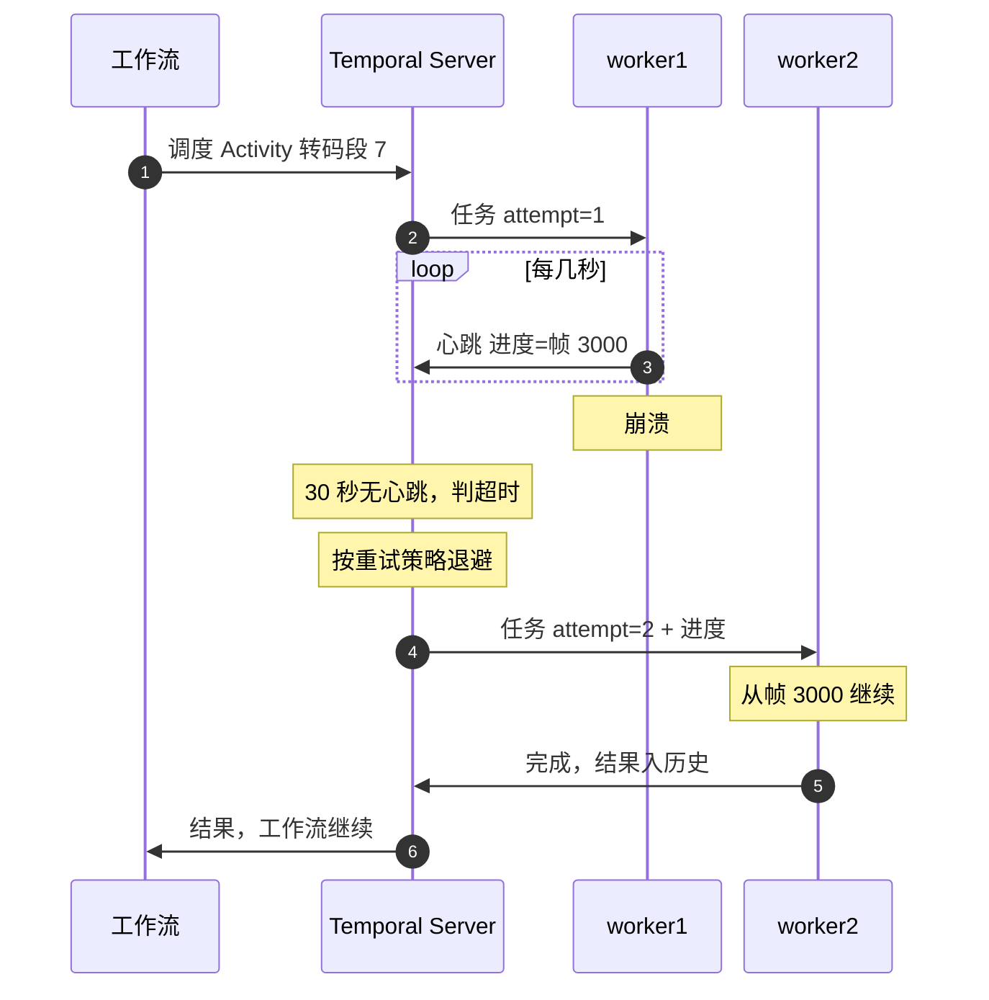

## Q
**长任务 · Temporal：Activity 超时、心跳与在另一台 worker 上重试**｜拓展 · 必会

用 Temporal 跑转码，执行 Activity 的 worker 崩了。是谁发现的？任务怎样交给另一个 worker？新的 worker 又怎样从上次的进度继续，而不是从头再来？

## A
Temporal Server 不监视 worker 进程，它只知道自己派出的每次 Activity 尝试上有几个计时器在走；到期还没收到心跳或结果，就判这次尝试失败，按重试策略把同一个 Activity 放回任务队列，任何在轮询的 worker 都可能拿到下一次尝试。心跳可带进度（heartbeat details），下一次尝试读出来从断点继续。

| 超时 | 量的是什么 | 用法 |
|---|---|---|
| Start-To-Close | 单次尝试最长多久 | 与 Schedule-To-Close 至少设一个；崩溃检测的兜底 |
| Heartbeat | 两次心跳最长间隔 | 长任务要快速发现崩溃就设它，与总时长无关 |
| Schedule-To-Close | 含全部重试的总时限 | 限制整个 Activity 最多花多久 |
| Schedule-To-Start | 任务在队列等多久 | 少用；排队久通常是 worker 不够，监控更合适 |



```python
@activity.defn
async def transcode_segment(seg: Segment) -> str:
    details = activity.info().heartbeat_details     # 上一次尝试最后的心跳进度
    start = details[0] if details else 0
    for frame in encode_from(seg, start):
        activity.heartbeat(frame)                   # SDK 会节流，不是每次都发
    return seg.output_key                           # 确定性键，重做只是覆盖
# 工作流里调度
await workflow.execute_activity(
    transcode_segment, seg,
    start_to_close_timeout=timedelta(minutes=10),
    heartbeat_timeout=timedelta(seconds=30),
    retry_policy=RetryPolicy(maximum_attempts=5,
                             non_retryable_error_types=["CorruptInput"]),
)
```

- **崩溃到继续：** worker1 拿到第 1 次尝试后每编码一段帧心跳一次；它死了，Server 的心跳计时器 30 秒内没收到就判超时（没设心跳超时只能等 Start-To-Close 的 10 分钟），退避后把第 2 次尝试放回队列，worker2 拿到并读出最后心跳的进度（帧 3000）继续，结果写入工作流历史。
- **僵尸 worker：** Temporal 不杀超时的旧尝试，它的完成回报会被拒（任务令牌属于已结束的尝试），但对外部的写入照样发生，所以 Activity 要幂等：确定性输出键，或带幂等键调外部服务。
- **毒输入：** 默认重试次数不限，坏输入会被永远重试；设 `maximum_attempts`，把确定失败的错误列为不可重试，用完后失败抛回工作流，由它标记视频失败并告警。
- **心跳也是取消通道：** 不发心跳的长 Activity 收不到取消。
- **工作流 worker 崩溃：** 工作流本身默认不重试，靠历史重放在另一台 worker 恢复，已完成的 Activity 结果从历史读，不重跑。
- **为什么这样：** 只设很长的 Start-To-Close，崩溃后要等满才重试，心跳超时让发现时间与任务长度无关；在 Activity 里自己 `while` 重试，状态在进程内存里一死就丢，交给 Server 重试策略则换哪台 worker 都能继续。
- **数字：** 默认重试：初始间隔 1 秒、退避系数 2.0、最大间隔 100 倍、次数不限；设了心跳超时时 SDK 按其 80% 节流发送，没设则默认节流 30 秒、上限 60 秒。
