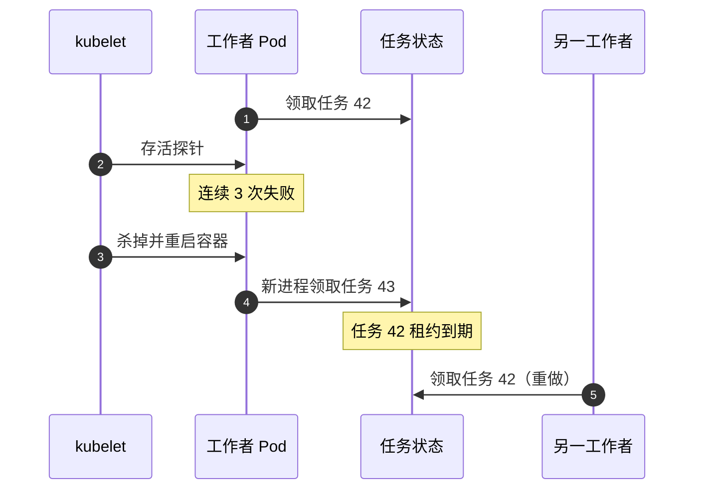

## Q
**长任务 · 进程重启与任务回收：为什么 Kubernetes 重启代替不了租约**｜拓展 · 加分

工作者跑在 Kubernetes 上，有存活探针（liveness probe），挂了会自动重启。还需要可见性超时、租约或心跳超时吗？反过来，有了任务级回收，还要存活探针吗？

## A
两层管的东西不同。进程级监管（kubelet 的存活探针、systemd 的自动重启）让"工作者这个进程"恢复运行，但它不知道进程手里拿着哪个任务，重启出来的新进程只会去领新任务。任务级回收（可见性超时、消费者组再均衡、租约过期、Activity 心跳超时）让"那个任务"换人继续，但它不管旧进程会不会回来。缺了任何一层都会留下一个洞。

**步骤**
1. **领取：** 工作者 Pod 领到任务 42，在任务状态（SQS、租约表、Temporal）里留下到期时间。
2. **探测：** kubelet 定期执行存活探针。
3. **判定：** 连续失败达到阈值，kubelet 认为容器不健康。
4. **重启：** kubelet 杀掉容器并重启。内存里任务 42 的进度随之消失。
5. **新进程不认旧账：** 新进程对任务 42 一无所知，只会领新的任务 43。
6. **任务层回收：** 任务 42 的租约或可见性计时到期。
7. **转交：** 另一个工作者领走任务 42，幂等地重做。

| 场景 | 进程级（探针重启） | 任务级（超时回收） |
|---|---|---|
| 进程崩溃 | 重启容器，新进程领新任务 | 旧任务超时后被别人领走 |
| 整台节点宕机 | 要等节点被判失联、Pod 被驱逐后重建，通常是分钟级 | 超时一到就转交，与节点无关 |
| 进程活着但死锁，心跳线程照跑 | 探针若检查真实进展，就能发现并重启 | 若心跳与进展无关，租约被一直续期，任务永远不回收 |
| 毒消息让进程反复崩溃 | 重启救不了，容器进入 CrashLoopBackOff | 尝试次数上限把它送进死信 |
| 发布或缩容 | 发 SIGTERM，给宽限期 | 停拉新任务，做不完就主动放手 |

**故障与处理**
- **心跳要绑在进展上：** 在处理循环里、每完成一块（帧、片段、一批行）之后续租或心跳。不要另起一个只要进程活着就续租的定时线程，否则卡死的任务会被永远续下去。再加一个总时限兜底：Temporal 的 Start-To-Close、SQS 从首次接收起 12 小时的上限、租约表里的截止时间列。
- **存活探针也要查进展：** 探针检查"处理循环最近有没有前进"，而不是端口能不能连上；失败阈值乘以探测周期要大于单块最长处理时间，否则正常的长任务会被误杀。
- **就绪探针（readiness probe）：** 它决定 Pod 是否接收 Service 流量；拉模式的工作者不接流量，控制它是否干活的是"停止拉取"，而不是就绪状态。
- **主动放手：** 收到 SIGTERM 来不及做完时，立刻交还任务（SQS 把可见性设为 0、租约表把 `lease_until` 置为过去），不必让别人干等超时。

**为什么这样，不那样**
- **只靠 Kubernetes：** 重启只恢复容量，不恢复进度；节点宕机时还要等分钟级的驱逐。
- **只靠任务回收：** 卡死而不退出的进程会一直占着一个工作者名额，甚至反复领任务再卡住；需要进程级重启把它清掉。

**数字**
- **探针默认值：** 每 10 秒探测一次（`periodSeconds`），超时 1 秒，连续 3 次失败（`failureThreshold`）才重启，所以最快约 30 秒。
- **宽限期：** Pod 的 `terminationGracePeriodSeconds` 默认 30 秒，之后强杀。
