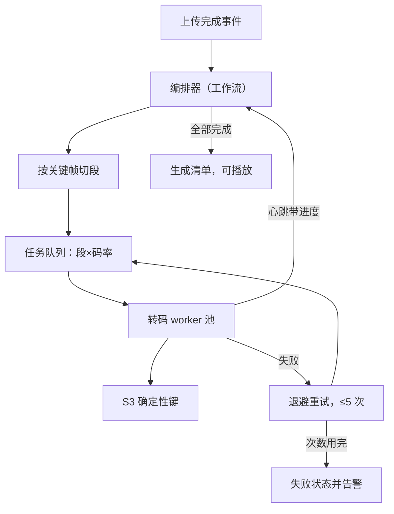

## Q
**长任务 · 长且可并行的流水线怎样扛住工作者故障（以视频转码为例）**｜拓展 · 必会

一段两小时的视频要转成 5 档码率。工作者随时可能崩溃、变慢或被缩容。最佳实践的容错设计是什么？每一步由哪个组件负责？

## A
不要把两小时的视频当作一个任务交给一个工作者：崩溃发现慢、从头重做、无法并行。做法是由编排器（Temporal、Step Functions，或任务表加状态机）持有整条流水线的状态，把工作切成几十秒到几分钟的小任务放进任务队列：每个任务短超时、可重做、可并行；输出写到由任务决定的键，重复执行只是覆盖；失败按退避有限重试，用完进入失败状态等人处理。

- **切小：** 按关键帧（GOP 边界）切段，每个「段×码率」一个任务；超时设得短、崩溃很快发现、只重做一段，几百段并行几分钟转完。工作者从任务队列拉取，加工作者就加吞吐，不受分区数限制；工作者之间不互相通知，状态在编排器（排队、转码中、完成、失败）。
- **心跳带进度：** 心跳超时 30 秒远小于任务上限，崩溃 30 秒内被持有状态的一方（Temporal Server、SQS 计时、租约表）发现并交给别人。
- **幂等输出：** 输出键 `videos/{videoId}/{rendition}/seg_{n}` 只由任务决定，重做或两个副本同时写都落到同一个键、内容相同。
- **有限重试：** 瞬时错误（节点回收、对象存储 503）指数退避加抖动，最多 5 次；确定性错误（输入损坏、编解码器不支持）标为不可重试立刻失败。用完次数后 Activity 失败抛回工作流，标视频 `failed` 并告警（队列方案进死信队列），修好可重放。
- **扇入：** 所有段所有码率完成后，编排器生成 manifest 并标为可播放；靠编排器记的状态，不靠「最后完成的工作者」猜自己是不是最后一个。
- **掉队者（straggler）：** 某段耗时远超同批中位数时另发一份副本（推测执行），谁先完成用谁，确定性键保证不冲突；输入特别大是切分不均，副本一样慢，不适用。
- **故障：** 工作者崩溃或变慢：计时到期、重新入队、另一工作者覆盖同一个键，晚到的完成被拒、晚到输出相同无害。编排器崩溃：状态在历史或任务表里，换 worker 重放，已完成的段不重跑。缩容或发布：收到 SIGTERM 停拉新任务，当前段做完或交还。整批失败率突增多半是下游出问题，按失败率告警。
- **为什么不是别的：** Kafka 消费者组一条慢消息挡整个分区，超过 `max.poll.interval.ms` 反复再均衡且无单条重试；工作者之间直接串联（编舞）扇入难做、没人知道卡在哪一段；只靠 Kubernetes 重启恢复的是进程，不会把它手里的段交给别人。
