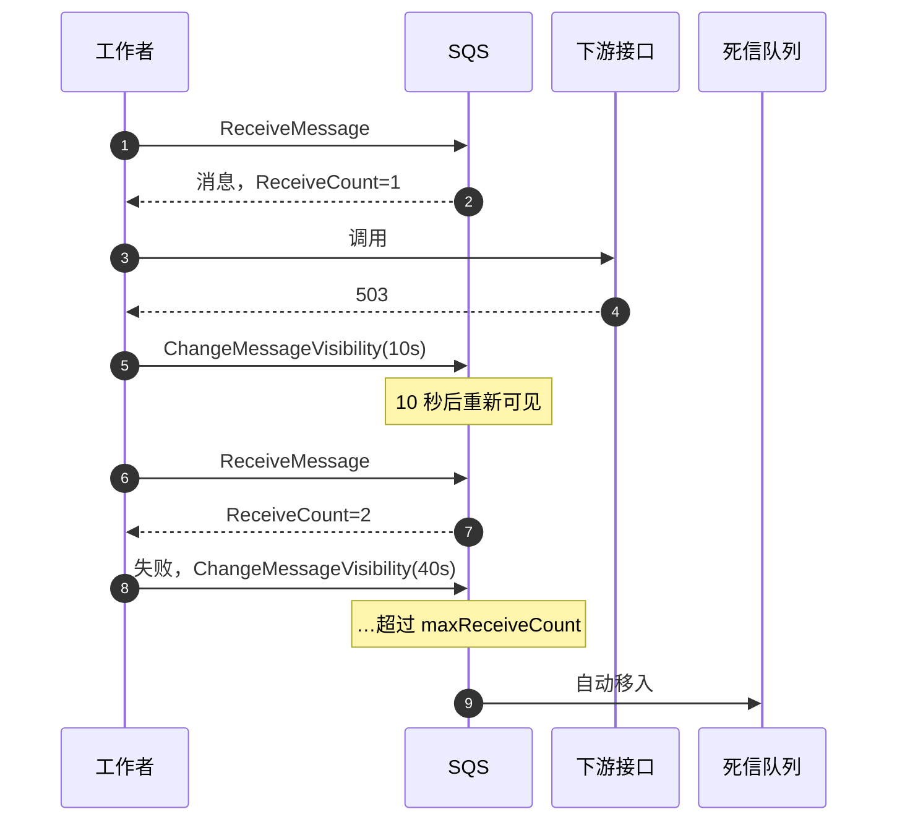

## Q
**长任务 · SQS 失败重试的退避：用 ChangeMessageVisibility 推迟，maxReceiveCount 兜底**｜拓展 · 追问

下游接口偶尔 503。工作者处理失败时，如果什么都不做，消息 30 秒后重新可见，紧接着又失败，几分钟就进了死信队列。怎样让重试按 10 秒、40 秒、160 秒这样退避？`maxReceiveCount` 该设多少？

## A
**一句话。** 失败时不删消息，而是用这次的回执句柄调 `ChangeMessageVisibility`，把可见性超时设成按接收次数算出的退避时间；消息到时重新可见、再被领取，`ApproximateReceiveCount` 加一；超过重驱动策略（redrive policy）的 `maxReceiveCount`，SQS 自动把它挪进死信队列。

**步骤。**
1. **领取：** `ReceiveMessage` 时请求属性 `ApproximateReceiveCount`，得到"这是第几次被接收"。
2. **失败分类：** 只有可重试的错误（超时、429、5xx）走退避；参数错误、数据损坏这类永远不会成功的，直接写失败记录并 `DeleteMessage`，不要白白重试。
3. **算退避：** `delay = min(上限, 基数 × 4^(n−1)) + 随机抖动`，n 为接收次数。抖动让同一时刻失败的大批消息不会同时回来。
4. **推迟：** `ChangeMessageVisibility(ReceiptHandle, VisibilityTimeout=delay)`。新的超时从这次调用时刻起算，最大 43200 秒（12 小时）。
5. **再领：** 到时消息重新可见，任何工作者都能领到，接收次数加一，回执句柄换新的。
6. **兜底：** 队列的重驱动策略设 `maxReceiveCount`，接收次数超过它的消息被移入死信队列，并告警。

**限制。**
- **只对这一次接收有效：** `ChangeMessageVisibility` 设的值不会保存在消息上；下次接收后若不再修改，用回队列默认的可见性超时。
- **12 小时上限：** 超时不能超过"剩余可用时间"，设太大会直接报错，SQS 不会替你截短。更长的等待要换调度表或工作流引擎。
- **接收次数不等于失败次数：** 主动放回、处理超时、批量领取后没来得及处理，都会计数。`maxReceiveCount` 要比应用里的最大重试次数多出几次余量。
- **标准队列的额外行为：** 设了重驱动策略且 `maxReceiveCount` 大于 3 时，被接收 3 次以上仍未删除的消息会被挪到队尾，`ApproximateAgeOfOldestMessage` 只反映还没到这个次数的消息。
- **死信的保留期：** 标准队列的消息在死信队列里仍按最初入队时间过期，所以死信队列的保留期要比源队列长。

**为什么这样，不那样。**
- **在工作者里 `sleep` 再重试：** 占着线程和可见性时间，进程一重启进度全丢。
- **失败后重新发一条带 `DelaySeconds` 的新消息：** 也行，但新消息的接收次数从 1 开始，`maxReceiveCount` 就失效了，要自己在消息体里记次数；而且 `DelaySeconds` 最多 15 分钟。
