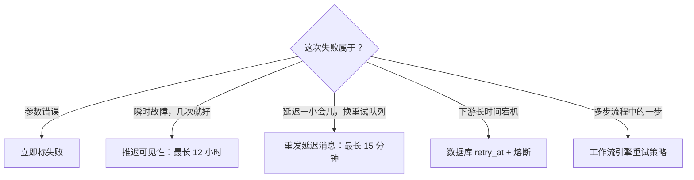

## Q
**长任务 · 失败后"过一会儿再试"的四种放法**｜拓展 · 加分

任务失败后要延迟重试。可以推迟原消息的可见性、重发一条延迟消息、在数据库里记下次时间、或交给工作流引擎。各自能延迟多久？重试次数记在哪？什么时候选哪个？

## A
**一句话。** 秒到分钟级、次数少，推迟原消息的可见性最省事，次数由 SQS 的接收计数记；要超过 12 小时、要能查询和取消、要按任务精确控制，就把"下次执行时间"写进数据库或交给工作流引擎，队列只负责"到点了就执行"。

**四种放法。**
- **推迟原消息（`ChangeMessageVisibility`）：** 最长 12 小时（从第一次接收算起）。次数就是 `ApproximateReceiveCount`，超过 `maxReceiveCount` 自动进死信队列。看不到"有哪些在等重试"，也不能提前取消。
- **重发延迟消息（`SendMessage` 带 `DelaySeconds`）：** 最长 15 分钟，FIFO 队列不支持按消息设置延迟。新消息的接收次数从 1 开始，重试次数要自己写在消息体里，死信策略也要自己实现。适合"延迟一小会儿，并换一个队列（如低优先级重试队列）"。
- **数据库记下次时间：** 任务行写 `status = RETRY_WAIT, attempt = n, retry_at = now + delay`，删除原消息；调度器扫描 `retry_at <= now` 的行重新入队。延迟没有上限，能查询、能取消、能人工改，次数和最后一次错误都在行里。代价是多一个扫描器，并要用条件更新防止重复入队。
- **工作流引擎（Temporal 的 Activity 重试策略、Step Functions 的 Retry）：** 声明初始间隔、系数、最大间隔、最大次数，引擎持久地等待和计数；适合多步骤流程里的一步，单个简单任务用它偏重。

**怎么选。**
- **瞬时故障、几次就好：** 推迟可见性，`maxReceiveCount` 比重试次数多几次余量。
- **下游长时间宕机：** 写数据库的 `retry_at`，并按下游熔断：熔断期间不领取这类任务，而不是让每条消息各自退避到死信。
- **流程中的一步：** 交给工作流引擎的重试策略。

**易错。**
- **所有失败都退避重试：** 参数错误重试一百次也不会成功，应立即标失败。
- **重发新消息却忘了带次数：** 每次都是"第一次"，永远到不了死信队列，成了无限重试。
- **退避不加抖动：** 一次下游故障让上万条消息在同一秒一起回来，再把下游打垮。
