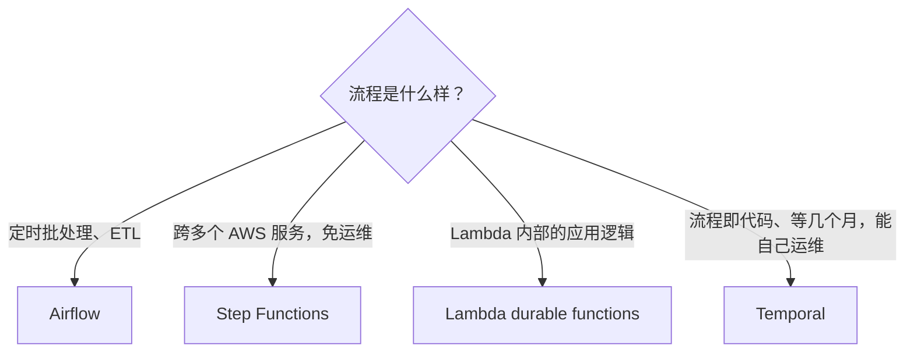

## Q
**多步流程 · 常见实现与选型**｜摘要 · 必会

Temporal、Step Functions、Airflow 等各自擅长什么？面试里选哪个、怎么答？

## A
- **共同点：** 都让工作流状态扛过失败、重启甚至代码发布。恢复机制不同：Temporal 用重放代码对照历史重建状态；Step Functions 在服务端记录状态机位置，直接继续。
- **Temporal：** 最强的开源选择。能等几天几个月、扛崩溃、保留每个决定的完整历史；流程是代码，循环、条件分支随便写。代价是要自己运维（或买 Temporal Cloud）。
- **AWS Step Functions：** 托管无服务器，用 JSON 状态机，表达力弱但无需运维集群。标准工作流最长运行一年，状态间负载上限 256KiB。
- **云厂商同类方案：** Azure Durable Functions、Google Cloud Workflows：同类云原生方案，比 Temporal 易运维但灵活性差。
- **2026 亮点：** AWS Lambda 也有了持久化执行原语（durable functions）：处理函数在等待或失败后从头重新调用，已完成的 step 直接返回存下的结果，单次执行最长一年。语义和 Temporal 一致：重放要求代码确定，step 默认至少一次，所以支付类 step 仍要带幂等键。选型上 Lambda 内部的应用逻辑用它，跨多个 AWS 服务的编排用 Step Functions，两者可混用。
- **Airflow：** 擅长定时批处理，DAG 用 Python 写，适合 ETL 数据管道，不适合事件驱动、长时间运行、面向用户的流程。

- **新选手：** DBOS（Postgres 之上的持久化执行）、Hatchet、Netflix Conductor（JSON 定义），被问到时点名即可。
- **面试要点：** 选哪个不重要，扣分的是不懂所选工具的恢复模型和局限；挑一个，讲清为什么适合。
