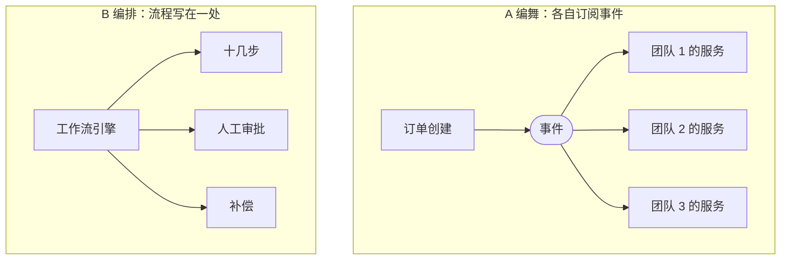

## Q
**多步流程 · 编舞还是编排**｜考点 · 必会

场景 A：三个由不同团队维护的服务，订单创建后各自反应。场景 B：十几步、有人工审批、有补偿、产品经常调整顺序的贷款流程。分别怎么选？

## A
- **A 用编舞：** 服务独立、耦合松，各自订阅事件即可，不需要中央协调者；新增订阅者很容易。
- **B 用编排：** 流程复杂且常改，需要一处看到全貌；编舞下流程隐含在事件约定里，改顺序要改许多工作者。用工作流引擎，流程写在一段代码里，还有集中的历史可排查。

- **判断依据：** 复杂度、变更频率、是否需要集中控制和可见性。
- **加分：** 两者可以混用：服务之间事件驱动，关键长流程用编排。
