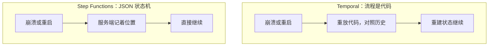

## Q
**多步流程 · 引擎选型怎么答**｜考点 · 必会

面试官问你选 Temporal 还是 Step Functions，你该怎么回答才不会扣分？

## A
- **扣分点：** 不是选哪个，而是不懂所选工具如何运作。
- **回答骨架：** 先说明为什么需要工作流（局部失败、长时间、补偿），再选一个并讲它的恢复模型与局限。
- **Temporal：** 流程是代码，重放历史恢复，表达力强、可等数月，要自己运维。
- **Step Functions：** JSON 状态机，服务端记位置，免运维，表达力受限，标准工作流最长一年、状态间负载 256 KiB。

- **2026 亮点：** 选型多了第三条路：Lambda durable functions 把 checkpoint 加 replay 做成 Lambda 的原语，不用运维集群，单次执行最长一年；仍要求重放代码确定、step 默认至少一次（支付 step 带幂等键，启动时用 execution name 当幂等键防重复启动）。Lambda 内部逻辑选它，跨多个 AWS 服务的编排选 Step Functions。
- **补充：** 在 AWS 环境常用 CDK 生成状态机，不要抱怨"JSON 难看"；两者在设计讨论里几乎可互换。
