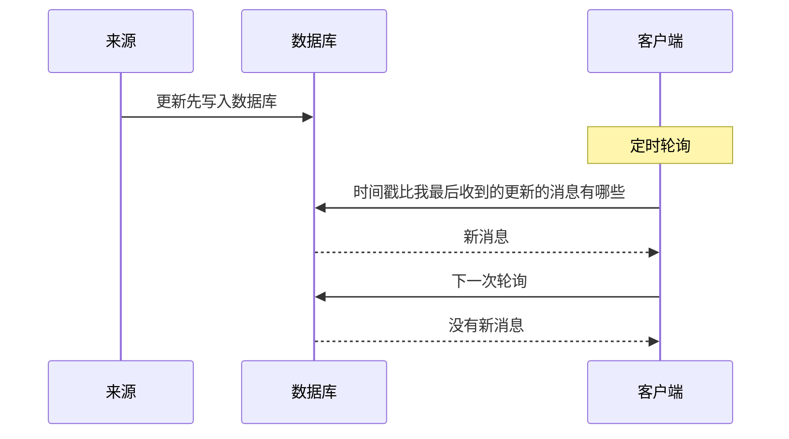

## Q
**实时更新 · 通过轮询拉取**｜摘要 · 必会

拉取模式下更新靠什么传递？它的优缺点和需要算的账是什么？

## A
- **做法：** 更新先写入数据库（如聊天室的全部消息），客户端按时间戳等条件拉取："这个房间里时间戳比我最后收到的更新的消息有哪些"。客户端的轮询本身就是触发，哪怕更新早就发生了。

- **优点：** 来源和接收方被数据库隔开（解耦）；状态只放在数据库里；不需要特殊基础设施；容易实现和讲解。
- **缺点：** 延迟高；更新稀少而轮询频繁时数据库压力白白浪费。
- **何时选：** 想让体验对后端变化更灵敏一点，但不要求"即时"；真需要实时时不是最佳选择，不过很多场景本来就不需要实时。
- **一定要算账：** 一百万客户端每 10 秒轮询一次，就是 100k 次/秒的读，容易被忘记。要讲清更新怎么存、怎么查（索引、按时间戳或序号增量取），负载大时怎么变。
