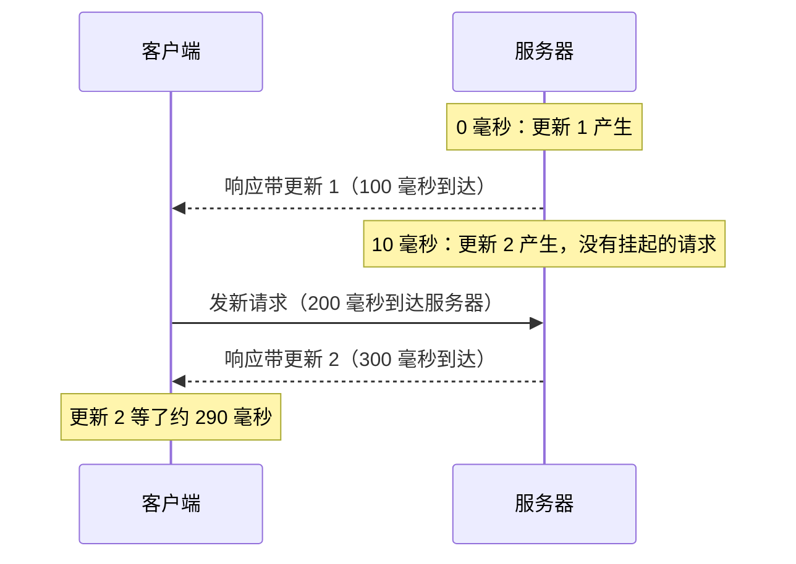

## Q
**实时更新 · 长轮询的延迟算账与超时对齐**｜考点 · 必会

单程网络延迟 100 毫秒，10 毫秒内先后产生两个更新。长轮询下两个更新分别最晚多久到达？为什么？另外，服务器愿意挂 60 秒，但负载均衡 30 秒就断开，会发生什么？

## A
- **第一个：** 约 100 毫秒到达（响应的网络时间）。
- **第二个：** 最多约 290 毫秒：第一个响应还在传输，剩余约 90 毫秒；客户端收到后再发新请求，要 100 毫秒到达服务器；服务器拿到请求发现已有更新，响应再花 100 毫秒。

- **原因：** 每次响应之后客户端必须"回头"发新请求，这段空窗里到达的更新要等下一轮。更新越密越明显，所以不适合高频更新；SSE/WebSocket 没有这个回头的往返。
- **超时错位：** 负载均衡 30 秒切断连接，客户端看到错误而不是正常的空响应；服务器还在持有已经无人接收的请求。解法：服务器挂起时间必须小于链路上最小的空闲超时，常用 15–30 秒后返回空响应，客户端无缝重发。
- **还要加：** 出错后重发前小小延迟，避免失败风暴。
