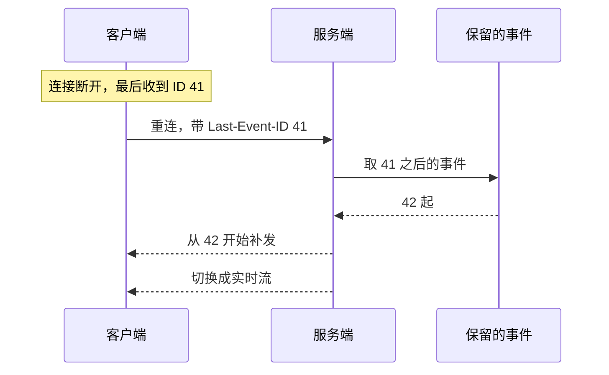

## Q
**实时更新 · SSE 断线重连要服务端做什么**｜考点 · 必会

客户端的 SSE 连接断了，它最后收到的事件 ID 是 41，重连后怎样不丢也不重？服务端要保存什么？

## A
- **客户端：** 浏览器的 `EventSource` 自动重连，并在请求头里带 `Last-Event-ID: 41`。
- **服务端：** 事件必须带单调递增的 ID，并保留一段时间窗口的事件（环形缓冲、Redis Streams、Kafka 偏移量）。收到 41 后，从 42 开始补发，再切换成实时流。

- **不重：** ID 单调，客户端按 ID 去重（或服务端从严格大于 41 的开始）。
- **缺口太大：** 缓冲里最旧的事件是 100，而客户端只到 41，就无法补发，要告诉客户端整体重新拉取一次完整状态。
- **多台服务器：** 重连可能落到另一台服务器，所以事件日志必须是共享的（发布订阅配合可回放的存储），不能只存在上一台服务器的内存里。
- **连接寿命：** 负载均衡和代理常把单条连接的寿命或空闲时间限制在 30–60 秒，加上网络切换，重连是常态而不是异常，要保证它的成本低。
