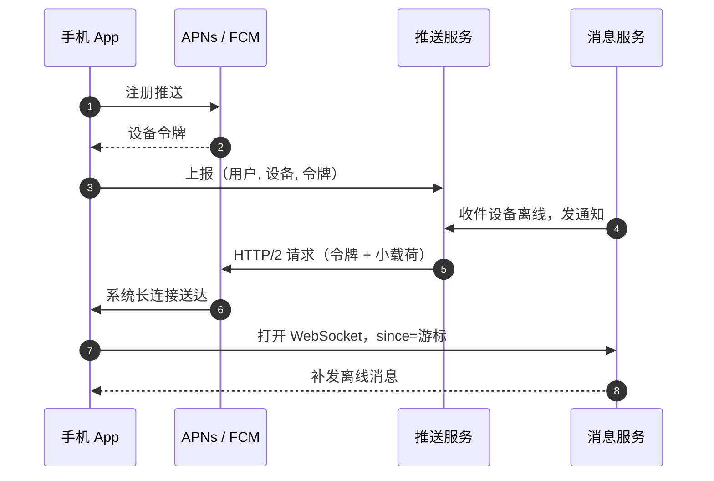

## Q
**实时更新 · 设备离线时，怎样用 APNs / FCM 叫醒 App**｜拓展 · 必会

聊天消息到了，收件人的手机 App 在后台、WebSocket 早已断开。服务端怎样让手机响一下，App 又怎样拿到真正的消息？设备令牌从哪来、存在哪？

## A
**一句话。** App 启动时向系统的推送服务注册，拿到设备令牌（device token）交给你的服务端保存；收件设备不在线时，服务端带着令牌调用苹果的 APNs 或谷歌的 FCM，由它们经各自与手机保持的系统级长连接把通知送到；通知只是"门铃"，App 醒来后通过自己的通道按游标拉取消息。

**步骤。**
1. **拿令牌：** iOS 上 App 调系统接口注册远程通知，拿到 APNs 令牌；Android 上 Firebase SDK 生成 FCM 注册令牌。令牌标识"这台设备上的这个 App"，会轮换。
2. **存令牌：** 服务端按（用户，设备）存一行：令牌、平台、App 版本、最后上报时间。App 每次启动都重新上报，令牌变了就覆盖。
3. **判断离线：** 消息服务查会话目录，收件设备没有在线连接（或连接所在网关已死），就交给推送服务。
4. **调用 APNs：** HTTP/2 请求发到 `api.push.apple.com` 的 `/3/device/<令牌>`，带 `apns-push-type`（alert 或 background）、`apns-priority`（10 立即、5 按省电考虑）、`apns-expiration`、`apns-collapse-id`，鉴权用 JWT 或证书。
5. **调用 FCM：** HTTP v1 接口 `projects/<项目>/messages:send`，消息里带 `token`、Android 的 `priority`（high 可以把休眠中的设备叫醒）和 `ttl`。
6. **送达：** 推送服务经系统维持的长连接把通知交给手机。App 不需要自己保持连接，这是它能在后台、甚至被系统挂起时收到的原因。
7. **拉取正文：** 用户点开或 App 被唤醒后，连回自己的服务，按"最后收到的序号"拉取缺失的消息。推送里不放正文，只放会话 ID 和序号；端到端加密的应用尤其不能把明文交给第三方。

**为什么这样，不那样。**
- **App 在后台自己保持 WebSocket：** 移动系统会挂起后台 App、断掉它的网络，耗电也不允许；只有系统级的推送通道能可靠地叫醒设备。
- **把完整消息放进推送：** 载荷有大小上限，推送服务会合并、丢弃，并且送达没有保证；消息的事实来源必须是自己的消息库和收件箱。

**数字。**
- **载荷上限：** APNs 普通通知 4 KB（4096 字节），VoIP 通知 5 KB；FCM 也是 4096 字节。
