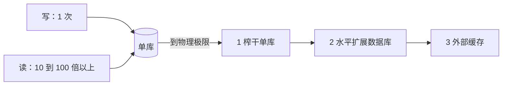

## Q
**读扩展 · 问题所在**｜摘要 · 必会

为什么读流量一定会压垮数据库？读写比通常是多少？

## A
- **读远多于写：** 刷一次信息流要拉几十张图的元数据、用户信息、点赞数、评论预览，可能上百次读，而你一天可能只发一张图（一次写）。一条推文被成千上万人读，一个商品被成百上千人浏览。
- **读写比：** 起点是 10:1，内容型应用常达到 100:1 甚至更高，所以读流量增长比写快得多。
- **根因是物理极限：** CPU 每秒能执行的指令有限，内存容量有限，磁盘 I/O 受限于介质速度。到了这个点，写再多代码也没用，必须靠架构手段把读负载分出去。
- **解题顺序：** 先榨干单库，再水平扩展数据库，最后加外部缓存。

