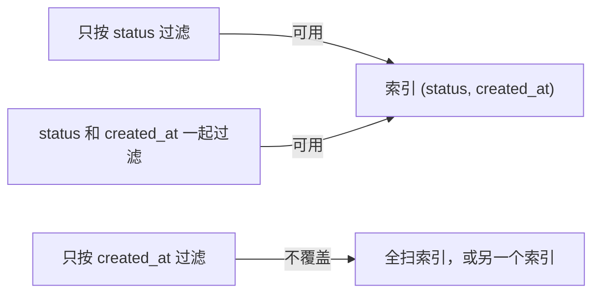

## Q
**读扩展 · 复合索引顺序**｜考点 · 必会

查询有三种：只按 `status` 过滤；按 `status` 和 `created_at` 一起过滤；只按 `created_at` 过滤。一个复合索引怎么建，覆盖哪几种？

## A
- **建 `(status, created_at)`：** 索引先按 status 排序，同 status 内再按 created_at 排序。
- **覆盖：** 只按 status 过滤，可用；按 status 加 created_at 一起过滤，可用。
- **不覆盖：** 只按 created_at 过滤，因为索引的主排序键是 status，created_at 在其中并不整体有序，要全扫索引或需要另一个索引。

- **原则：** 把等值过滤、被最多查询使用的列放在前面。
