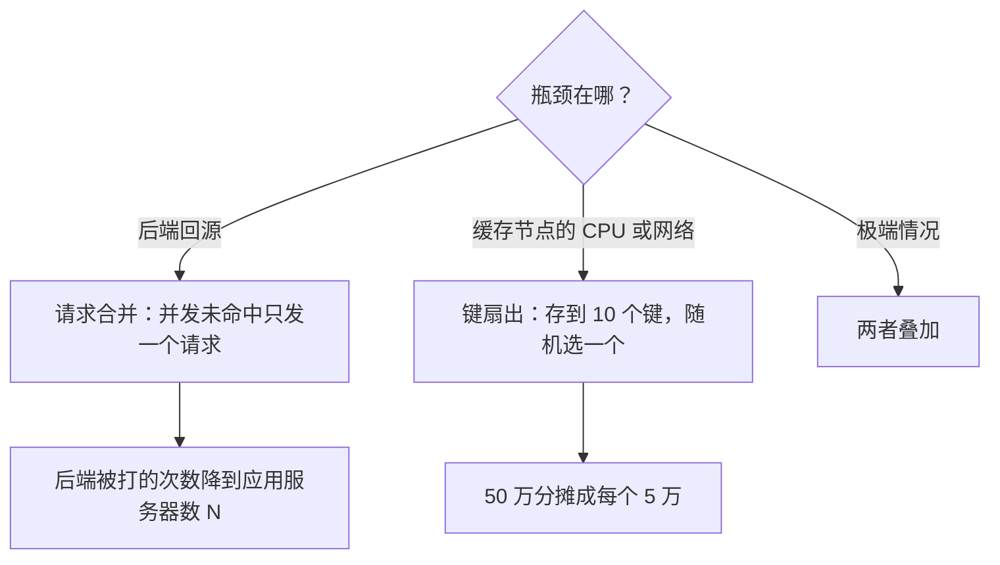

## Q
**读扩展 · 热键怎么选**｜考点 · 必会

一个键涌入每秒 50 万次读，缓存服务器撑不住。请求合并和键扇出分别解决什么问题，何时用哪个？

## A
- **请求合并：** 解决的是后端压力：同一个键并发未命中时只发一个请求，后端被打的次数降到应用服务器数 N。它不能减少缓存服务器收到的读次数。
- **键扇出：** 解决缓存服务器本身的单键吞吐上限：同一份数据存到 10 个键，随机选一个，把 50 万分摊成每个 5 万。
- **选择：** 瓶颈在后端回源就用合并；瓶颈在缓存节点的 CPU 或网络就扇出；极端情况两者叠加。

- **扇出的代价：** 占内存，失效要清全部副本。
