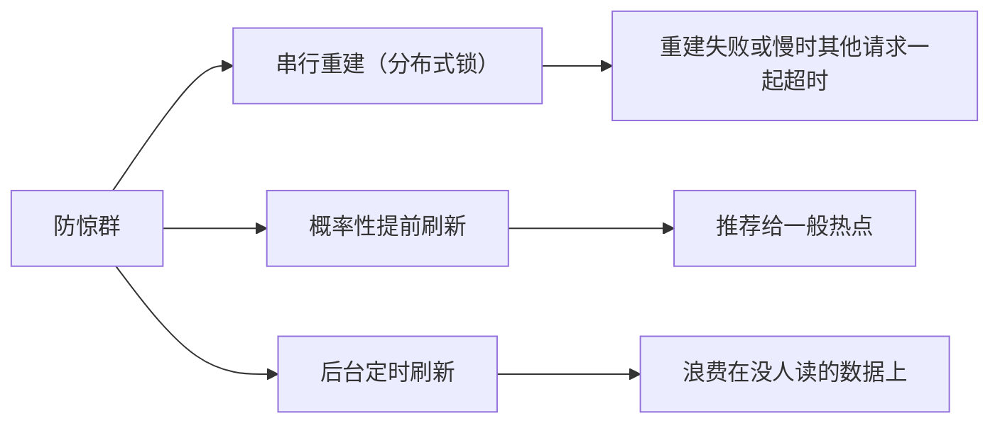

## Q
**读扩展 · 惊群怎么防**｜考点 · 必会

首页缓存 TTL 到期瞬间数据库被打垮。你推荐哪种方案，各自的问题是什么？

## A
- **串行重建（分布式锁）：** 只让一个请求回源，但重建失败或慢时其他请求一起超时，要复杂的超时与降级。
- **概率性提前刷新：** 条目越老，请求触发后台刷新的概率越高，刷新分散到到期前的一段时间，多数用户仍拿缓存。推荐给一般热点。
- **后台定时刷新：** 最关键的数据在到期前就由后台任务更新，用户永远不触发重建；代价是基础设施和对没人读的数据的浪费。

- **资深加分：** 给 TTL 加随机抖动，避免大量条目在同一时刻过期。
