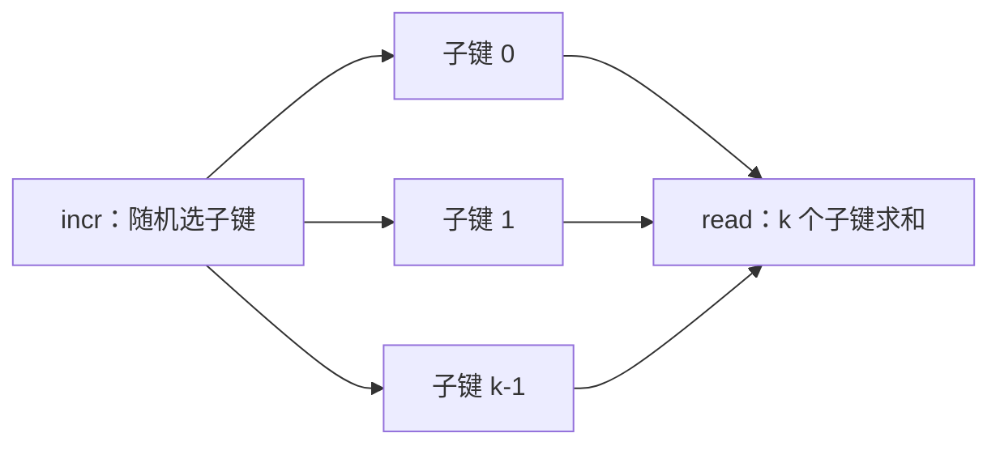

## Q
**写扩展 · Python：子键计数与窗口合并**｜拓展 · 加分

热键计数拆成子键，点赞合并成批，用代码怎么表达？

## A
**模式。** 子键拆分计数（sharded counter）与窗口合并（write coalescing）。

```python
import random
import threading
from collections import Counter
from typing import Callable


class ShardedCounter:
    def __init__(self, k: int = 8) -> None:
        self.k = k
        self._cells = [Counter() for _ in range(k)]   # 现实中是落在不同分片的 k 个键
        self._locks = [threading.Lock() for _ in range(k)]

    def incr(self, post: str) -> None:
        i = random.randrange(self.k)      # 随机选子键，写入均匀分散
        with self._locks[i]:
            self._cells[i][post] += 1

    def read(self, post: str) -> int:
        return sum(c[post] for c in self._cells)   # 读放大 k 倍，漏读一个就少算


class LikeBatcher:
    def __init__(self, flush: Callable[[dict[str, int]], None]) -> None:
        self._flush = flush
        self._pending: Counter[str] = Counter()
        self._lock = threading.Lock()

    def like(self, post: str) -> None:
        with self._lock:
            self._pending[post] += 1

    def tick(self) -> None:               # 定时器每个窗口调用一次
        with self._lock:
            batch, self._pending = dict(self._pending), Counter()   # 换出整批，临界区很短
        if batch:
            self._flush(batch)            # 慢 I/O 放在锁外
```



- **子键锁各自独立：** 写者只争 k 把锁之一，所以锁冲突降到 1/k；读取没有全局快照，读到的是各子键此刻值之和，实时计数可接受。
- **批处理器的代价：** 换出整批后崩溃会丢这个窗口的计数，能容忍或能从上游重放才可用。
- **何时不用：** 计数不热、窗口内同一键很少重复时，两者都只是增加复杂度。
