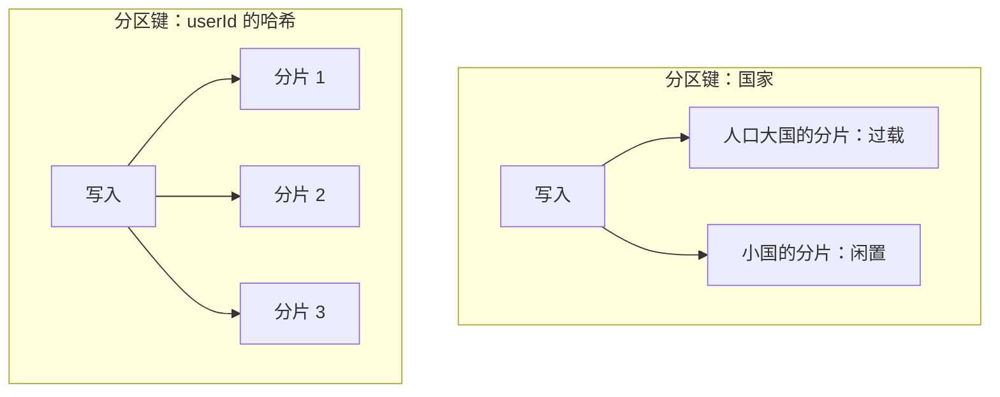

## Q
**写扩展 · 分区键选错**｜考点 · 必会

为了让同一国家的数据在一起，你用国家做分区键。会发生什么？更好的键是什么？

## A
- **后果：** 人口大国的分片写入过载，小国的分片闲置，各分片负载方差很大，水平扩展的收益大打折扣。
- **更好的键：** 对主标识符做哈希，如 userId、postId，写入均匀分散。

- **要看读路径：** 如果大多数查询需要跨很多分片收集数据，开销也很大；自问"一个请求要访问多少分片、多久发生一次"。
- **取舍：** 把常一起访问的数据放在同一分片，与均匀分散写入之间需要平衡。
