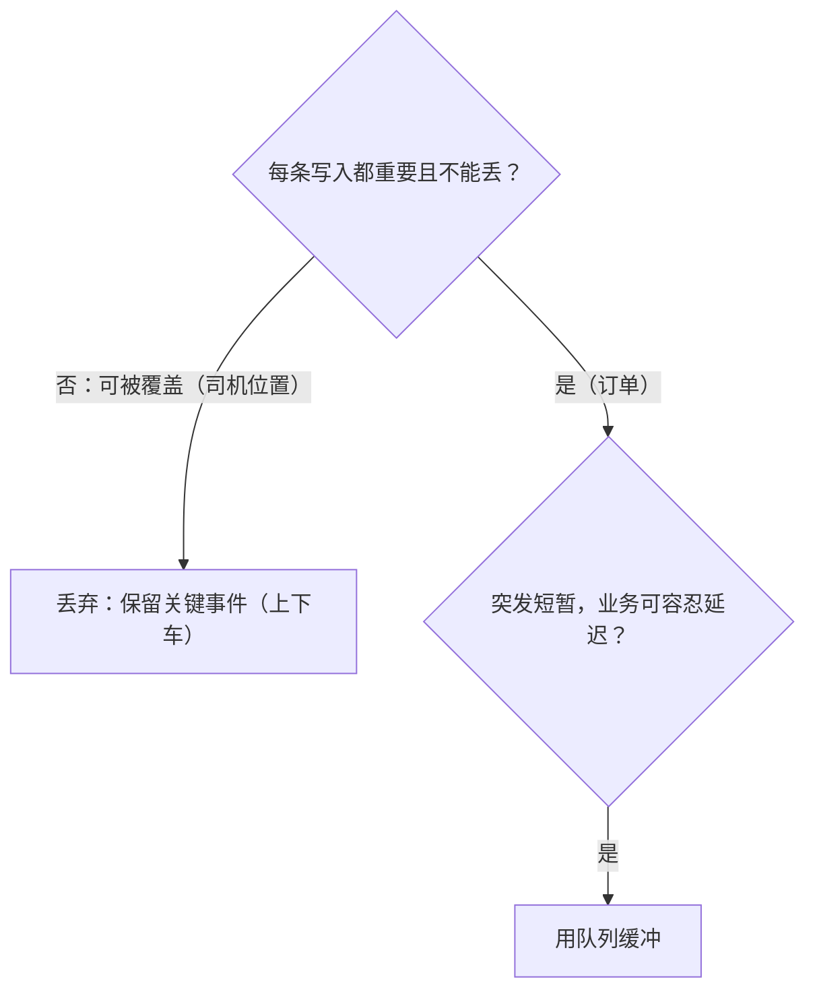

## Q
**写扩展 · 队列还是丢弃**｜考点 · 必会

司机位置每 4 秒上报一次，高峰期写入暴涨。你该用队列缓冲，还是丢弃？

## A
- **优选丢弃：** 位置上报是可被覆盖的，丢一条后几秒内就会有更新鲜的一条。队列会让旧位置堆积，到处理时已经没用，积压还可能无限增长。
- **怎么丢：** 丢掉紧随上一条的位置更新，保留关键事件（上下车）。
- **何时用队列：** 每条写入都重要且不能丢（订单），突发是短暂的，且业务可以容忍延迟。

- **要点：** 先判断写入的价值和可替代性，再选缓冲还是丢弃。
