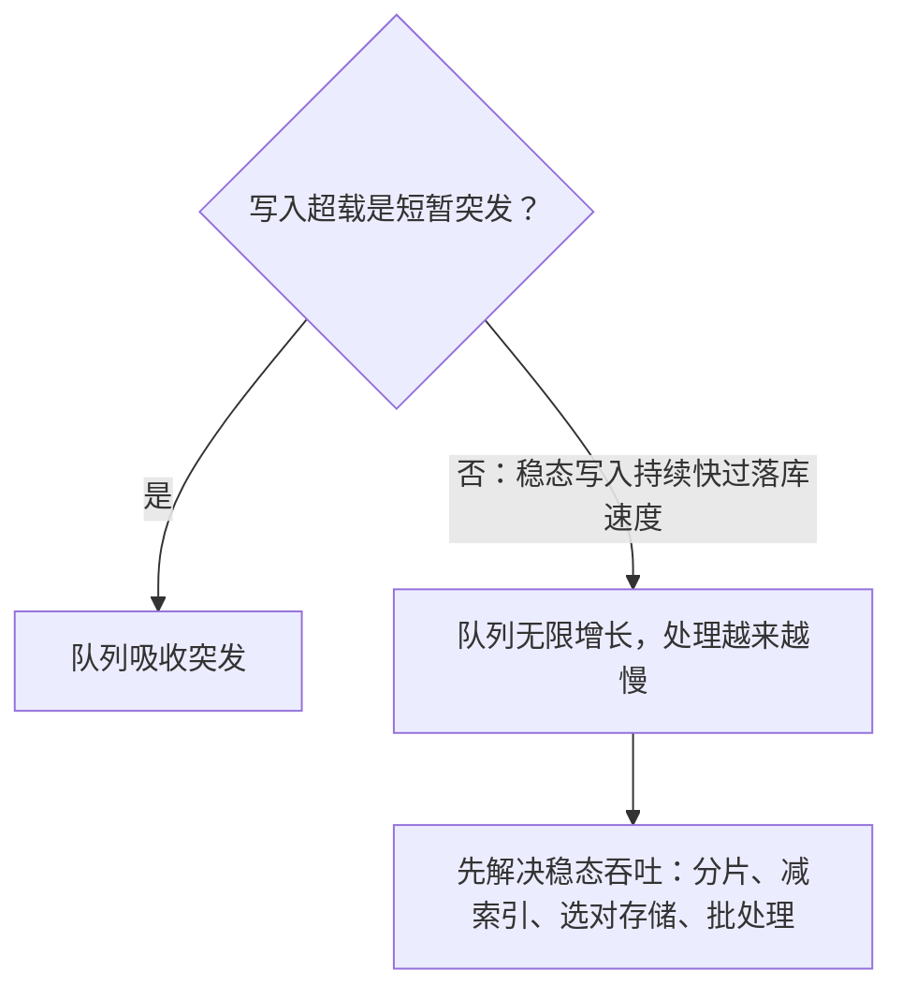

## Q
**写扩展 · 队列掩盖了什么**｜考点 · 必会

数据库一直写不过来，你想"加个 Kafka 缓冲"。这样做合理吗？

## A
- **不合理：** 队列只对短暂突发有效。稳态写入持续快过落库速度时，队列无限增长，处理越来越慢，且用户已被告知写入被接受。
- **扩容也不是瞬时：** 即使数据库扩容，积压排空前用户仍在等。
- **正确做法：** 先解决稳态吞吐：分片、减索引、选对存储、批处理；队列只用来吸收突发。

- **同时要问：** 需求是否容忍延迟写和不一致读，客户端如何得知写入最终完成。
