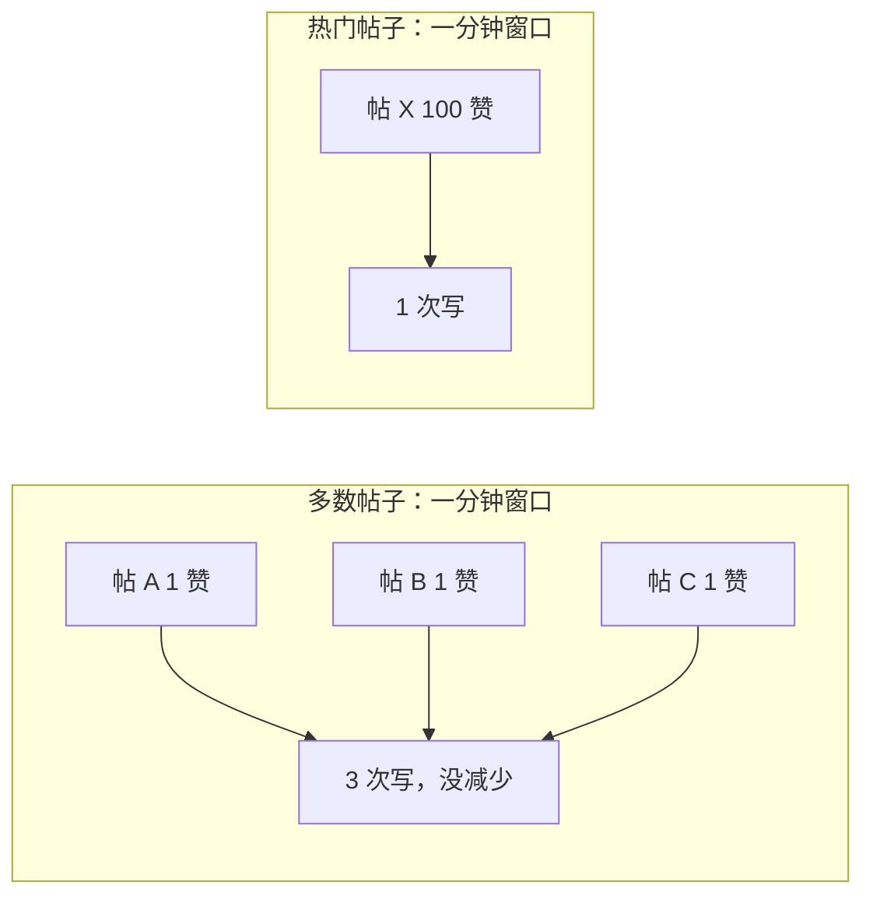

## Q
**写扩展 · 批处理有没有用**｜考点 · 必会

点赞事件进批处理器，窗口一分钟。多数帖子每小时才一个赞，这个批处理有用吗？

## A
- **几乎没用：** 窗口内同一帖子很少出现第二个事件，每个批里都是不同帖子的单个赞，写入次数并没减少。
- **有用的条件：** 热门帖子在窗口内收到大量赞，100 个赞合并为 1 次写。
- **改进：** 只对热点批处理，或加长窗口，或按帖子热度分级；衡量合并比（事件数 / 写入数）。
- **风险：** 批在内存里时宕机会丢这一窗口，要能接受丢失或能从上游重放。

