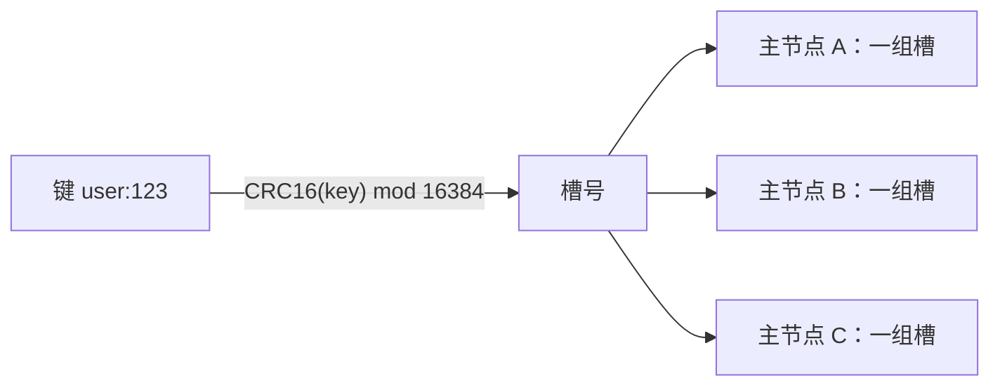

## Q
**分布式缓存 · 拓展：Redis Cluster 实际用的是哈希槽**｜拓展 · 加分

面试官问"Redis Cluster 的分片和你讲的一致性哈希是一回事吗"，怎么回答？

## A
- **不是传统的环：** Redis Cluster 把键空间固定分成 16384 个哈希槽（hash slot），槽号 = CRC16(key) mod 16384；每个主节点负责一组槽。
- **加减节点：** 按槽搬迁，把若干槽从旧节点迁到新节点，迁移期间客户端可能收到 MOVED / ASK 重定向，再去正确的节点。
- **2026 亮点：** 迁移期间的 MOVED / ASK 重定向是逐 key 搬迁的老做法；Valkey 9.0 的原子槽迁移和 Redis 8.4 开源版的 `CLUSTER MIGRATION` 把整个槽原子交接，源节点在交接完成前保留全部 key，客户端不再遇到半迁移的槽。代价：最后交接时源节点会短暂暂停该槽的写入。
- **与一致性哈希的相似与差异：** 目的一样（节点变化只搬一部分），但槽的映射是显式记录的，可以精确控制搬哪些槽、搬多少，不依赖环上的随机位置，运维更可控；代价是要维护槽映射表，所有节点通过 gossip 交换。
- **客户端：** 智能客户端缓存槽映射，直连正确节点；收到 MOVED 就更新映射。
- **多键操作：** 只有同槽的键才能一起操作；用哈希标签 `{user:123}` 让相关键落在同一个槽。
- **模式。** 间接层：加一层固定数量的槽，把"键 → 节点"拆成"键 → 槽 → 节点"，让迁移粒度和节点数脱钩。

