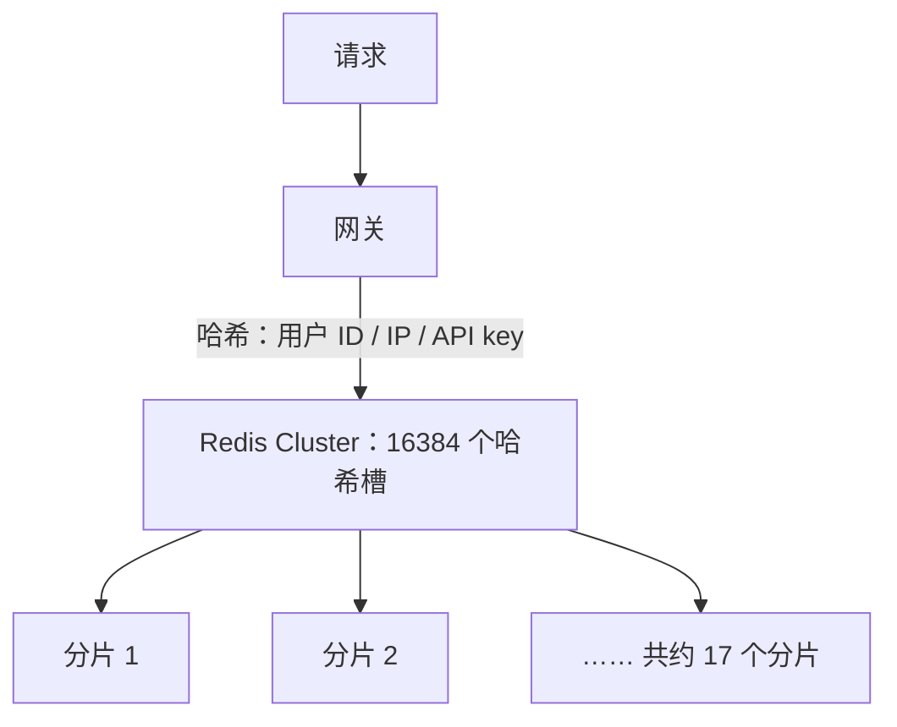

## Q
**分布式限流器 · 深入一：扩到每秒 100 万次——分片 Redis**｜摘要 · 必会

单个 Redis 为什么撑不住 100 万次/秒？怎么分片，生产中用什么？

## A
- **算账：** 单个 Redis 大约每秒 10–20 万次操作。一次检查至少要读（HMGET）再写（HSET），所以单实例只能做约 5–10 万次检查/秒。目标 100 万次/秒，必须把负载分散到多个实例。
- **更稳的估算：** 把读改写合成一个 Lua 脚本，一次检查就是一次 EVAL，单分片约 10 万次/秒。10 个分片刚好等于 100 万，没有余量，峰值或故障转移时就会撑破。按 60% 利用率留余量，需要约 17 个分片（1,000,000 ÷ 60,000）。
- **分片规则：** 同一个客户端的所有请求必须落到同一个分片，否则状态被拆开就没用了。对用户 ID（登录用户）、IP（匿名用户）、API key（开发者）分别取哈希，用一致性哈希映射到分片；网关带着路由逻辑去找对应的 Redis。令牌桶算法本身不变，只是连的是不同实例。
- **生产做法：** 用 Redis Cluster，它把键分到 16384 个哈希槽，再把槽分给各节点，`alice:bucket` 属于哪个节点由集群算，网关不必自己写一致性哈希。
- **模式：** 写扩展（scaling writes）：每秒百万次原子读改写，按键分片是核心手段。

