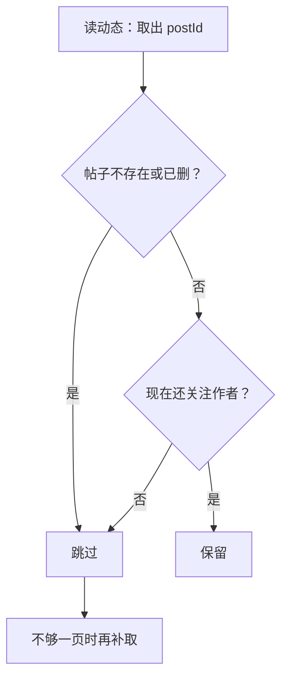

## Q
**动态流 · 拓展：删帖、取消关注和新关注怎么保持动态正确**｜拓展 · 加分

预计算动态里只存 postId。帖子被删、用户取消关注、用户新关注一个人时，已经写好的动态怎么办？

## A
- **只存 ID 的好处：** 动态里只放 postId，读时再去 Post 表（或缓存）取内容，所以帖子被编辑后用户马上能看到新内容，不用改动成千上万份动态。
- **删帖：** 不去逐份删除动态，读时发现帖子不存在或已删除就跳过（惰性过滤），少量空洞可以接受，不够一页时再补取。
- **取消关注：** 同理，读时按当前关注关系过滤；也可以异步清理该用户动态里属于被取消者的帖子。
- **新关注：** 新关注的人的旧帖子不在预计算动态里，可以把对方最近几条帖子回填进去，或标成需要读时合并，直到动态自然滚动。
- **原则：** 动态是派生数据，可以略不准，最终以 Follow 表和 Post 表为准；修复靠读时校验和异步重建。
- **模式。** 惰性删除：不在写路径上追着清理，读时过滤，后台整理。

