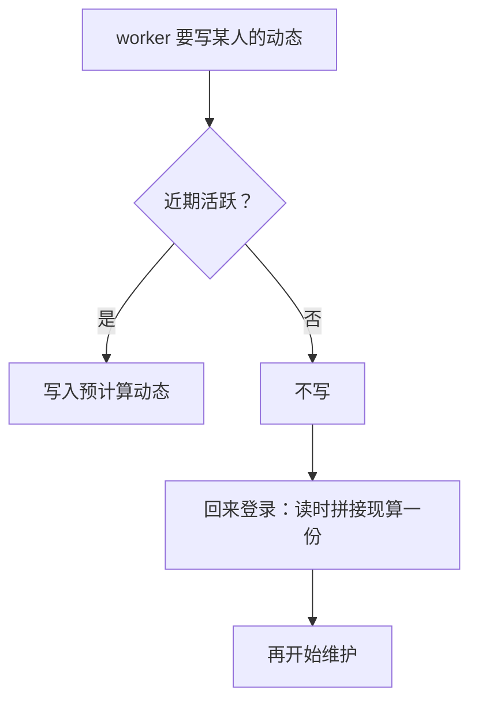

## Q
**动态流 · 拓展：只给活跃用户预计算**｜拓展 · 加分

20 亿用户里大部分每天并不打开应用。给所有人预计算动态合算吗？

## A
- **浪费：** 给长期不登录的用户每次都写动态，写入量很大却没人读。
- **做法：** 只给近期活跃的用户维护预计算动态（比如最近若干天登录过）；不活跃的用户不写，他们回来登录时，用朴素的读时拼接现算一份，再开始维护。
- **效果：** 把写放大的基数从总用户数降到活跃用户数，存储也相应减少；代价是回归用户第一次打开较慢，可以接受。
- **配套：** 需要一个「最近活跃时间」信号，并用它决定 worker 要不要写某人的动态；动态可设 TTL，长期不读自动过期。
- **同类思想：** 与混合扇出同源：不要对所有人用同一种策略，根据账号特征分别处理。

