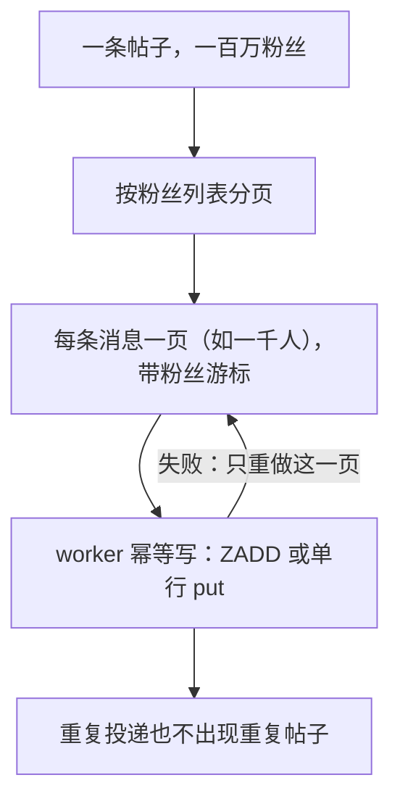

## Q
**动态流 · 拓展：往动态里写必须幂等，列表该用什么结构**｜拓展 · 加分

SQS 是至少一次投递，worker 可能把同一个帖子写进同一个人的动态两次。动态存在 DynamoDB 里，「在最前面追加并裁剪到 200 条」好做吗？

## A
- **重复投递：** 同一条消息被处理两次，不幂等的「在头部追加」会让动态里出现重复帖子。
- **改成幂等：** 让写操作幂等：如果用 Redis 有序集合，成员是 postId、分数是时间，`ZADD` 重复写入同一成员只是更新分数；然后 `ZREMRANGEBYRANK` 裁剪到 200 条。
- **DynamoDB 的限制：** 列表属性虽然可以用 list_append 在头部拼接，但没有「头部插入并按长度裁剪」的原子操作，裁剪要先读出整个列表再整体改写，并发写入会互相覆盖，重复投递还会插入重复项。更自然的建模是每条动态一行：分区键 userId，排序键为时间加 postId，写入是单行的幂等 put，读时倒序取前 200 条；淘汰旧行靠 TTL 或定期清理。
- **拆分大任务：** 一条队列消息不要代表「给一百万粉丝写」，而是按粉丝列表分页，每条消息处理一页（比如一千人），带上粉丝游标，失败只重做这一页。
- **模式。** 把大任务拆成幂等的小批次，重试安全。

