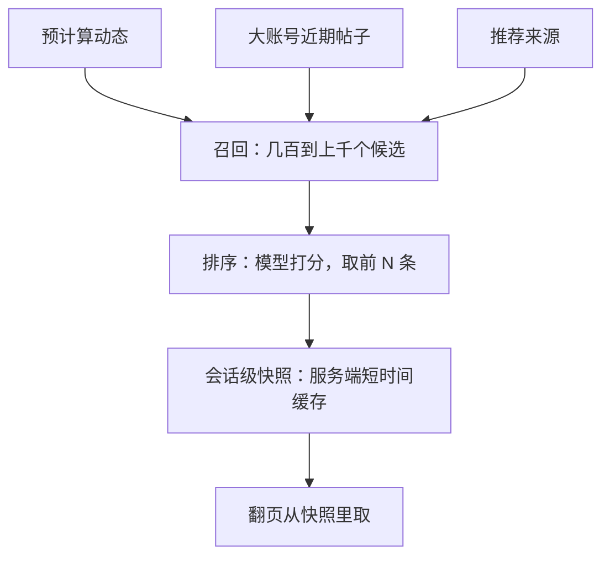

## Q
**动态流 · 拓展：从时间倒序到排序流**｜拓展 · 加分

面试官问：如果产品要从时间倒序改成按相关度排序，这个架构要怎么变？

## A
- **预计算的角色变了：** 预计算动态仍然保存候选帖子 ID，但不再是最终顺序；读时对候选集做排序，所以候选集要比一页大得多。
- **两阶段：** 召回（候选生成）：合并预计算动态、大账号近期帖子、可能还有推荐来源，得到几百到上千个候选；排序（ranking）：用模型对候选打分，取前 N 条。
- **延迟预算：** 总共仍要在 500ms 内返回，所以排序模型要轻，特征要预取并缓存；候选数是延迟和质量的旋钮。
- **翻页变难：** 分数会随时间变化，游标不能再是时间戳；要把第一次请求排好的结果在服务端短时间缓存（会话级快照），翻页从快照里取，或接受翻页时有轻微重复。
- **缓存与新鲜度：** 排序结果缓存的有效期短，新帖子需要有曝光机会（新鲜度加成）。
- **要点：** 先答出架构分层，再说明翻页和延迟的取舍。

