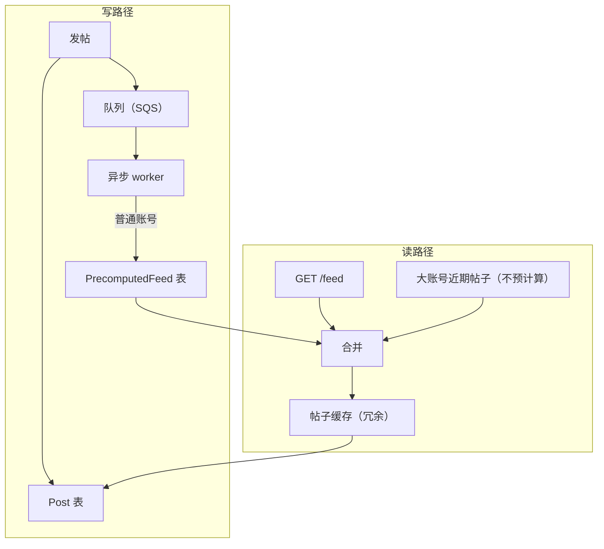

## Q
**动态流 · 完整解答**｜摘要 · 必会

设计 Facebook 动态流（News Feed）：用户发帖、单向关注别人，按时间倒序看到自己关注的人的帖子并能翻页；20 亿用户，关注数和粉丝数都不设上限。给出需求、实体与接口、整体设计、深入问题、各级别期望。

## A
**一句话。** 这是一道关于扇出（fan-out）的题：一个人关注海量账号，读时要拼很多次查询；一个账号有海量粉丝，写时要写很多份动态。解法是读时拼和写时算两种扇出按账号混合。

**60 分钟路线。**

| 时间 | 做什么 |
|---|---|
| 0–5 分 | 需求带数字：20 亿用户；发帖和看动态小于 500ms；可容忍约 1 分钟延迟 |
| 5–10 分 | 实体（User、Follow、Post）与三个接口 |
| 10–20 分 | 朴素设计走通四个功能，并口头点出三个警报 |
| 20–50 分 | 必讲深入：关注很多人（预计算动态）；粉丝很多（异步 worker 加混合）；热点帖子（冗余缓存） |
| 50–60 分 | 追问：存储估算、取消关注与删帖、活跃用户、排序 |

- **需求**
  - 功能：发帖；关注（单向）；按时间倒序看动态；翻页。点赞评论、私密帖放范围外
  - 非功能：可用性优先于一致性，帖子最多晚 1 分钟出现；发帖和看动态都小于 500ms；20 亿用户；关注和粉丝数无上限
- **实体与接口**
  - User、Follow、Post
  - `POST /posts`；`PUT /users/{id}/follow`（PUT 保证幂等，关注者来自 JWT）；`GET /feed?pageSize&cursor`，游标是已看到的最旧帖子的时间戳
- **朴素设计**
  - Follow 表（分区键 userFollowing、排序键 userFollowed，加反向 GSI）；Post 表加 GSI（creatorId、createdAt）
  - 读：取我关注的人，取他们的帖子，按时间排序。三个警报：关注多、每人帖子多、总集巨大。口头承认不能扩展再往下走
  - 翻页：游标是已看到的最旧帖子的时间戳，复用 Post 表的 GSI 取更旧的帖子
- **深入一，关注很多人**
  - 读时扇出一次读拆成成百上千次查询，延迟高
  - 写时预计算：PrecomputedFeed 表，userId 为键，值是约 200 个 postId，保持紧凑，只按 userId 访问；没人会翻一百页，需要更多就回退到朴素读法
  - 估算：每个 postId 约 10 字节，20 亿用户 × 2KB 约 4TB，合理；先问能不能调整产品，如限制关注数
- **深入二，粉丝很多**
  - 同时全部发出请求不可行，且各发帖服务器负载不均
  - 队列加异步 worker（如 SQS，至少一次投递）按粉丝写入各人动态，但大账号一条消息工作量巨大，要拆分
  - 混合：Follow 表加「不预计算」标记，worker 忽略大账号的帖子；读动态时把预计算部分与这些大账号的近期帖子合并，阈值可调
  - 例如 9000 万粉丝在 1 分钟内要写约 150 万次/秒，不可行
- **深入三，热点帖子**
  - Post 表的热点键：帖子很少编辑，用长 TTL 加 LRU 的缓存；按 postId 分片的缓存，爆款仍压垮一个分片；冗余缓存（每个实例能服务任一帖子，互不协调）让吞吐变成 N 倍，代价是冷启动多几次回源
- **级别**
  - 中级：功能完整的设计，不要求覆盖所有扩展；高级：至少两个深入并主动提出扇出；Staff：覆盖所有深入还能指出调优点

