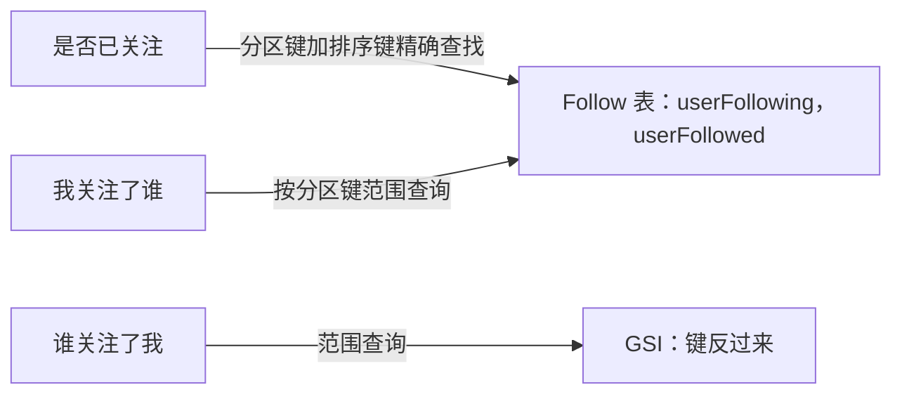

## Q
**动态流 · 发帖与关注的存储**｜摘要 · 必会

发帖服务怎么扩展？关注关系为什么不用图数据库，用 DynamoDB 怎么建模、能支持哪三种查询？

## A
- **发帖：** 水平扩展的服务放在 API 网关和负载均衡后；服务无状态，只往数据库写，加机器即可。存储用 DynamoDB 这类键值库，前提是负载均匀分散在各分区。
- **关注是多对多的图关系：** 图数据库（如 Neo4j）适合多跳遍历，如朋友的朋友、推荐。这里只有简单查询，用图库会引来「Neo4j 怎么扩展」之类的额外问题，所以用键值库自己建模。
- **Follow 表：** 分区键 userFollowing，排序键 userFollowed；再建一个全局二级索引（GSI），键反过来。
- **三种查询：** 是否已关注：分区键加排序键精确查找；我关注了谁：按分区键范围查询；谁关注了我：查 GSI 的范围。
- **注：** AWS 推荐 DynamoDB 单表设计，面试里分开建表更清晰，也完全可以。

