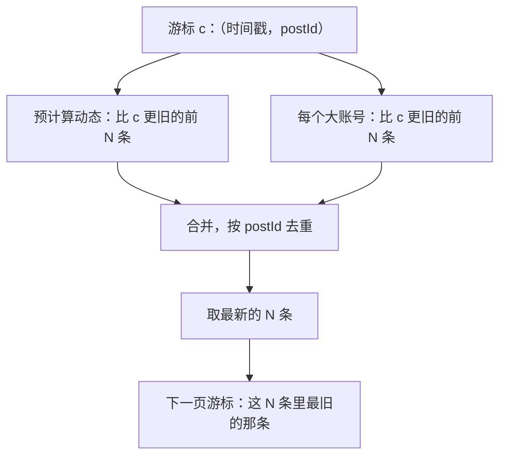

## Q
**动态流 · 翻页的边界：游标与混合合并**｜考点 · 必会

预计算动态每人存 200 条，每页 20 条，游标是时间戳。用户翻到第 11 页会发生什么？两条帖子时间戳相同会怎样？混合方案下，大账号的帖子在翻页时怎么合并才不重不漏？

## A
- **第 11 页：** 预计算的 200 条已经用完（10 页），要回退到朴素路径：查 Follow 和 Post 表取比游标更旧的帖子，动态服务要能无缝切换。
- **时间戳相同：** 只用时间戳做游标，同一时刻有多条帖子，翻页边界会漏掉或重复。游标应改为（时间戳，postId）的复合键，以此做严格排序。
- **合并不重不漏：** 每一页都用同一个游标 c，分别从预计算动态里取「比 c 更旧」的前 N 条，再从每个大账号取「比 c 更旧」的前 N 条，合并后取最新的 N 条，下一页游标设为这 N 条里最旧的那条。
- **为什么每个来源都要取 N 条：** 最新的 N 条可能全来自同一个来源，少取就会漏。
- **去重：** 帖子 ID 在预计算动态和大账号查询里可能重复出现（比如刚关注），合并时按 postId 去重。

