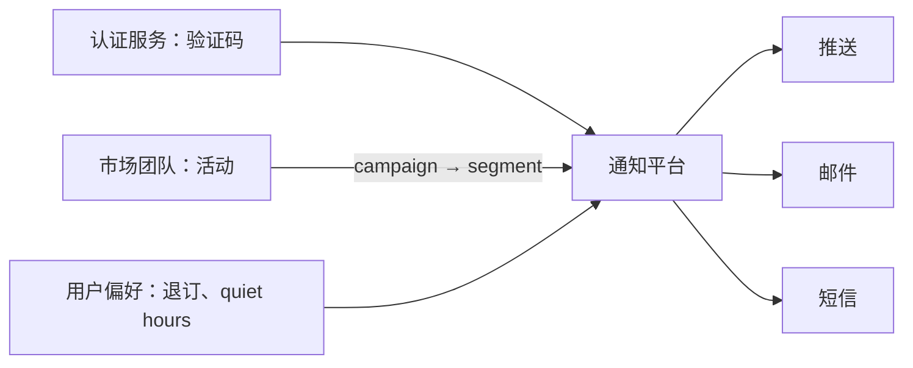

## Q
**通知系统 · 功能需求与范围**｜摘要 · 必会

通知系统要满足哪几条功能需求？哪些明确不做？这个系统和用户产品相比在"客户"上有什么不同？

## A
- **平台题，不是用户产品：** 客户是公司内别的工程团队。认证服务发验证码、市场团队给一百万用户群发促销，都是它的调用方。
- **核心功能三条：**
  - 上游服务可以向某个用户发推送、邮件或短信，立即或在将来某个时间发；
  - 上游服务可以发活动（campaign）：同一条消息发给一个人群（segment），可立即或定时；
  - 用户能设置偏好：按渠道退订、免打扰时段（quiet hours）。
- **范围外：** 模板管理与富文本、送达率与点击率看板、站内信与角标数、跨通知类型的频率上限。列范围外几乎不加分，时间紧就省略。
- **面试提示：** 通知题可以往很多方向走，面试官会引导你覆盖几个关键点，其余让你发挥；所以先收敛成这三条，把时间留给洪峰、不丢、去重。

