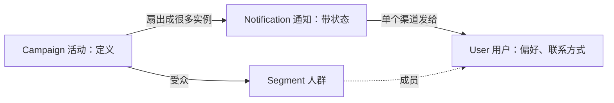

## Q
**通知系统 · 核心实体**｜摘要 · 必会

通知系统有哪些核心实体？活动（Campaign）和通知（Notification）是什么关系，这种关系在别的系统里还会出现吗？

## A
- **通知（Notification）：** 给单个用户、通过单个渠道的一条消息，带当前状态；例如"下午 4 点发给小王的营销邮件"。
- **活动（Campaign）：** 一次对人群的定时发送，记录发送时间、渠道和受众。
- **人群（Segment）：** 有名字的受众，如"加拿大所有用户"。成员由定义受众的工具维护，活动扇出时才读取。
- **用户（User）：** 接收人，带偏好与联系方式。
- **关系：** 通知是活动的实例，像类与对象：活动是定义，通知是它的一次次具体投递。
- **同样的形状：** 定时任务调度器里"循环任务和每次执行"、日历里"事件和它的各次出现"。看到"一个定义产生很多实例"，就要想到分别存储、分别记状态。
- **面试做法：** 一开始只列短清单，向面试官确认一致，字段等设计成形后再补。

