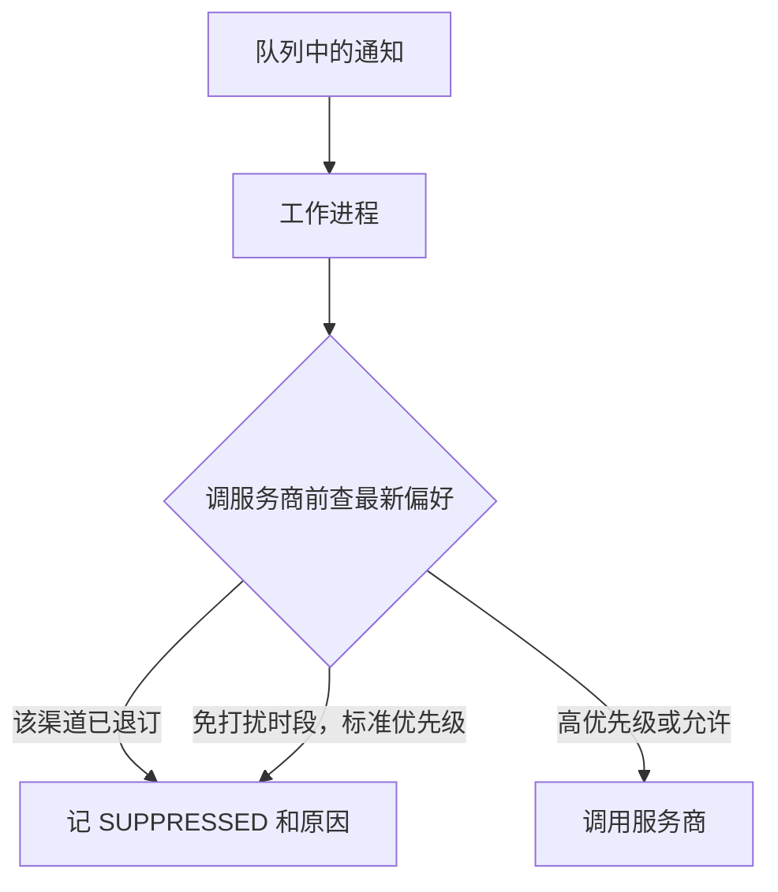

## Q
**通知系统 · 高层设计三：偏好与抑制**｜摘要 · 必会

用户偏好需要新组件吗？检查放在哪个环节？被拦截的通知应该怎么处理？

## A
- **不需要新组件：** 偏好是 User 的属性，经偏好接口写入，由网关路由到通知服务。
- **内容：** 每个渠道可以退订，另有免打扰时间窗；免打扰只约束标准通知，高优先级（验证码、欺诈提醒）不受限。
- **检查位置：** 每条通知在调用服务商之前检查。放在发送前而不是接受时，是因为定时发送和排队期间用户可能改了偏好，要按最新的决定。
- **被拦截的不要静默丢弃：** 记为 `SUPPRESSED` 并写原因。值班时被问到"这个用户为什么没收到"，能直接查到答案。

- **阶段结论：** 到这里系统在功能上完整：验证码一跳直发，百万用户活动由 cron 扇出，用户能管理偏好；但一条非功能需求都还没满足，下面的深入问题才解决它们。
