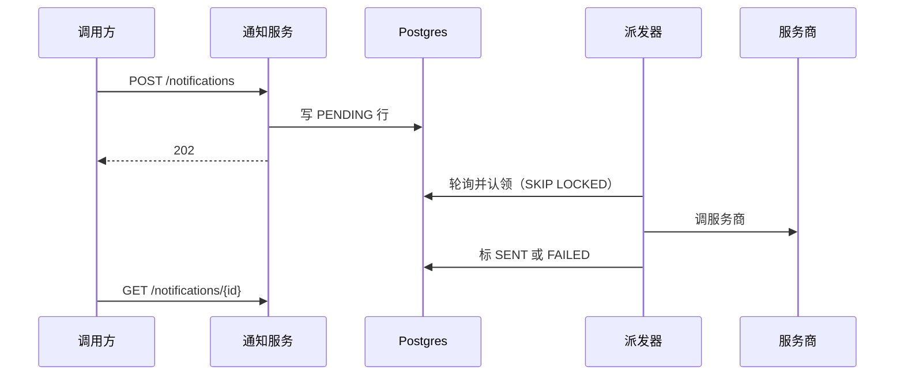

## Q
**通知系统 · 不丢：请求内重试与数据库轮询**｜摘要 · 必会

要保证"已接受的通知不会丢"，把服务商调用移出请求路径之前，常见的前两种做法（请求内重试、数据库轮询派发）为什么不够？

## A
- **请求内重试（差）：** 保持同步调用，失败就退避重试几次再返回。只修了最窄的问题（偶发失败）。
  - 重试循环在进程内存，崩溃或常规发布仍会丢；
  - 服务商故障时调用方连接被占着，认证服务因为我们短信商降级而登录超时，违背"快速失败、明确失败"；
  - 调用方分不清"我们放弃了"还是"我们没收到"，实际成了最多一次，和承诺相反。
- **数据库轮询派发（好）：** 写 `PENDING` 行就返回 202，后台派发器轮询 PENDING 行、调服务商、标 SENT 或 FAILED；先写行，派发器崩溃也不丢。调用方另用 `GET /notifications/{id}` 查结果。
- **它的代价是在 Postgres 上自建队列：**
  - 多个派发器会取到同一行而重复发送，需要 `SELECT ... FOR UPDATE SKIP LOCKED` 认领；
  - 重试要自己记次数和下次时间；
  - 表同时是队列和历史，越来越大，要裁剪或分区；
  - 延迟不会低于轮询间隔，10 秒一轮就慢。

