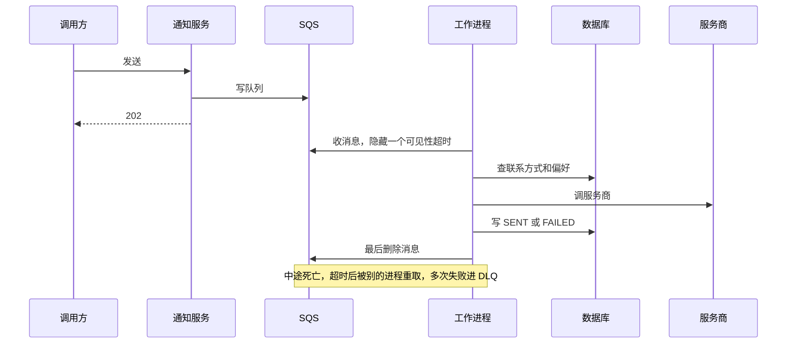

## Q
**通知系统 · 不丢：先发布到持久队列**｜摘要 · 必会

接受通知后直接写入持久队列（如 SQS）怎么工作？为什么不"先写库再发队列"，以及什么时候该选 Kafka？

## A
- **接受路径：** 通知服务只写队列，队列确认后返回 202；若入队前崩溃，调用方收到错误会重发。接受路径不再写数据库。
- **投递流程：** 工作进程从队列收消息（对其他进程隐藏一个可见性超时）→ 查联系方式并检查偏好 → 调服务商 → 把结果写进库（`SENT` 或 `FAILED`）→ 最后才删除队列消息。
- **容错：** 工作进程中途死亡，消息仍在队列，可见性超时到期后被别的进程重取；服务商失败按指数退避重试；失败次数过多进死信队列（DLQ），交人处理，不无限重试。重试策略、超时、DLQ 都靠配置，不用自己造。
- **新的问题：** SQS 至少一次，本身会产生重复，加上调用方也会重发，要去重；消费是破坏性的，删除后无法回放，上线了坏版本不能重放今天的流量。
- **先写库再发队列不可取：** 这是双写，两步之间崩溃会留下没有消息对应的行。发件箱（outbox）能解，但发件箱适合"数据库状态与消息要一起提交"，这里只是单次发布，没必要。
- **Kafka：** 优势是可倒带重放，坏版本上线后重置偏移量就能重处理；需求没要求，所以选 SQS，但选 Kafka 也成立。

