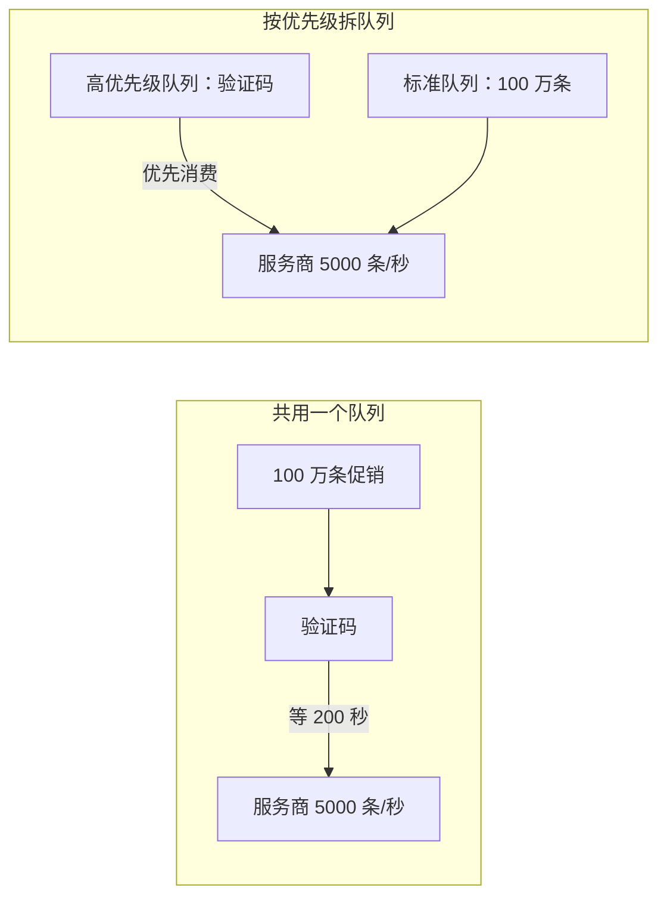

## Q
**通知系统 · 优先级：为什么共用队列与"加机器"都不行**｜摘要 · 必会

活动洪峰期间，验证码为什么会超时？"自动扩容工作进程"为什么不能解决？

## A
- **场景：** 上午 9 点市场团队给 100 万用户发活动，几乎瞬间全进队列。但服务商三个渠道合计只允许每秒 5000 条，所以积压约 1,000,000 ÷ 5,000 = 200 秒（三分多钟）才清完，对促销没问题。
- **问题：** 几秒后认证服务提交一条登录验证码，排在同一个队列里，前面有一百万条，等 200 秒，而目标是 5 秒。
- **加机器（差）：** 按积压量自动扩容工作进程。要在 5 秒内排空 100 万条，需要每秒 20 万条，是设计目标的 40 倍；新机器启动要几秒到几分钟，云账号有实例上限，而且大量闲置容量成本极高。
- **关键认知：** 天花板是服务商的速率限制，不是我们的工作进程，所以加算力解决不了。
- **按优先级拆队列（好）：** 调用方在接口声明优先级，高优先级队列单独、优先被消费，验证码在小队列里不受促销积压影响。
- **缺陷：** 只解决了排队位置，下游仍共享。标准流量可以占满我们在 Twilio 的全部额度，高优先级短信照样被服务商限流；工作进程若被慢的服务商调用卡住，也会拖住高优先级队列。

