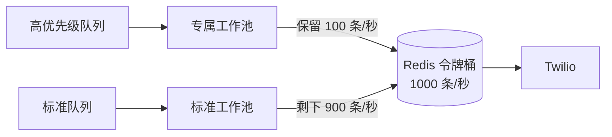

## Q
**通知系统 · 优先级：独立工作池加按层令牌桶**｜摘要 · 必会

怎样让高优先级通知在洪峰里仍有保障？按层的服务商额度怎么实现？这样做的代价是什么？

## A
- **隔离加控制：** 队列、工作池分开（隔离），服务商额度按层分配（控制）。
- **令牌桶：** 例如 Twilio 卖给我们每秒 1000 条短信。用 Redis 里共享的令牌桶，每个工作进程调服务商前先领令牌，每秒窗口开头补充：
  - 高优先级有保留份额，如 1000 里 100 条/秒只属于它；
  - 标准通知拿剩下 900，无论积压多深都不能动那 100。
- **独立算力：** 高优先级队列配专属的工作进程池，不会被标准流量的慢调用拖住。
- **代价：** 高优先级池大部分时间闲置，这是有意的取舍，换验证码和欺诈提醒随时可用；每次服务商调用前多一次 Redis 检查，多一个要做对的部件。
- **要点：** 隔离不能只做一层。队列位置、服务商额度、工作进程三处都共享，任何一处共享都会成为串扰点。

