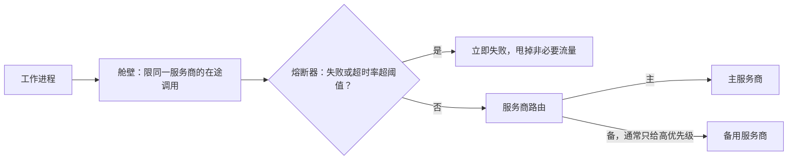

## Q
**通知系统 · 优先级：服务商变慢（brownout）怎么办**｜摘要 · 必会

Twilio 的 p99 延迟从不到 1 秒涨到 30 秒时，工作进程会发生什么？有哪三种常见对策？

## A
- **现象：** 工作进程不知道服务商变慢，继续调用，每个卡住的调用占住一个工作进程 30 秒。服务商降级时不可能全部按时送达，目标变成：高优先级继续流动，其余等它恢复。
- **熔断器（circuit breaker）：** 统计每个服务商的失败与超时率，超过阈值就打开，调用立即失败，不再傻等 30 秒超时，并且甩掉非必要流量，给高优先级让出容量。
- **舱壁（bulkhead）：** 限制对同一服务商的并发在途调用数，像信号量。Twilio 的额度占满后，不再让别的工作进程去调它，避免把全部容量耗在一个几乎挂掉的服务上。
- **服务商路由（provider router）：** 有替代品的渠道配主备；界面上也可以聪明一点，短信挂了，登录验证只提供邮件。备用通常只值得为高优先级层准备。
- **物理极限：** 无法违背物理让通知更快送达，可做的是把损失集中在能容忍的流量上。

