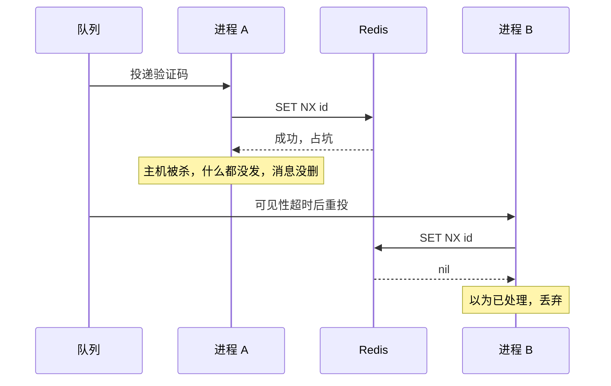

## Q
**通知系统 · 去重：重复从哪来，以及"先占坑再发送"的陷阱**｜摘要 · 必会

至少一次投递之下重复通知从哪些环节进入？"先用 SET NX 占坑再发送"为什么会把至少一次变成最多一次？

## A
- **重复进入的环节：**
  - 工作进程调完 Twilio、删除消息前死亡，可见性超时后另一个进程再发；
  - 上游 POST 超时后重发；
  - 活动扇出的 cron 发了一半崩溃，重跑把已入队的又入队一遍。
- **稳定 ID：** 先要有幂等键（deduplication key），重试必须产生相同的 ID，下游才能分辨。调用方在 `POST /notifications` 带幂等键，通知 ID 由它派生；活动消息的 ID 是 `campaignId:userId`，cron 重跑得到相同 ID。活动本身也要幂等键，否则重试创建得到新 `campaignId`，每个人收到两次促销。
- **占坑方案：** 发送前对该 ID 做 Redis `SET NX`（仅当不存在才写），原子操作，两个进程竞争时只有一个成功。
- **致命缺陷（以验证码为例）：** 进程 A 占坑成功，所在主机被发布杀掉，什么都没发，消息没被删；超时后重投给 B，`SET NX` 返回 nil，B 以为已处理而丢弃；此后每次重投都被丢弃。标记比持有者活得更久，丢失了一条验证码，至少一次变成最多一次。

- **本质：** 在"做完"之前就记录"已做"，崩溃后无法区分。
