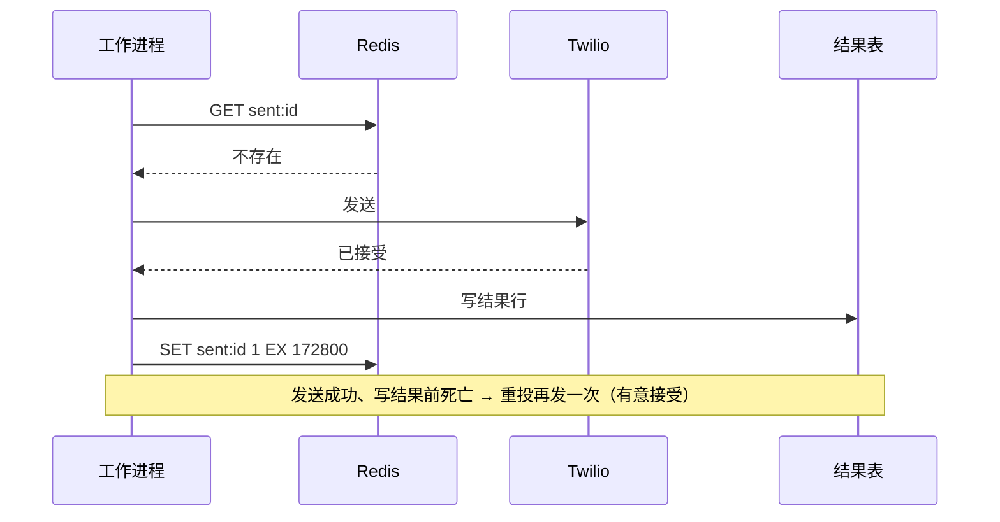

## Q
**通知系统 · 去重：发送前检查，服务商接受后再记录**｜摘要 · 必会

正确的去重顺序是什么？这个方案还剩什么重复窗口，Redis 或数据库不可用时怎么办？

## A
- **顺序翻转：** 发送前检查是否已发送，服务商接受之后才写标记。
  - `GET sent:{notificationId}`：存在就是重复，丢弃；
  - 发送，写库，然后 `SET sent:{notificationId} 1 EX 172800`，保留 48 小时以覆盖死信队列的回放。
- **分层：** Redis 缓存近期已发送 ID 挡在前面，数据库里的结果表是事实来源。直接每条查库在洪峰里会拖慢。
- **剩余窗口：** 工作进程调用 Twilio 成功、短信已发出，但在写结果之前死亡；重投时查不到记录，再发一次。这是有意接受的：宁可极少数重复，也绝不丢。

- **Redis 不可用：** 退回查结果表，查"成功发送"的记录而不是任意一行，更慢但正确。
- **数据库也不可用：** 照发，不让消息卡住；同时统计跳过检查的发送数，比例上升时告警。
- **面试表述：** 点明送达语义：精确一次到服务商边界就停了，诚实的设计是至少一次，并在每个可能进入重复的点做去重，要能在图上指出这些点。
