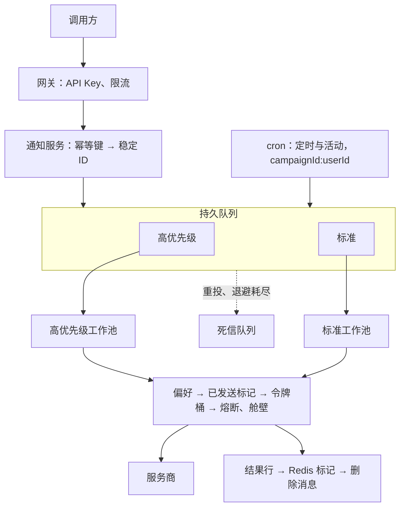

## Q
**通知系统 · 最终架构：各部件一览**｜摘要 · 必会

把不丢、优先级、去重三个深入问题合起来，通知系统的最终架构是什么样？

## A
- **接受路径：** 网关验 API Key、限流 → 通知服务校验幂等键、派生稳定 ID → 写入对应优先级的持久队列 → 返回 202。
- **定时与活动：** cron 扫定时行与活动，读人群快照，按 `campaignId:userId` 生成确定性 ID，发布到队列，而不是自己直接调服务商。
- **投递路径：** 高优先级与标准各有独立队列和工作池 → 工作进程检查偏好 → 先查已发送标记 → 领令牌桶额度 → 经熔断、舱壁调用服务商 → 写结果行 → 写 Redis 标记 → 删除消息。

- **兜底：** 可见性超时重投、指数退避、死信队列；被偏好拦截的写 `SUPPRESSED`。
- **每处防护对应的问题：** 队列解决不丢；独立池加预留额度解决验证码时延；先查后记解决重复。
