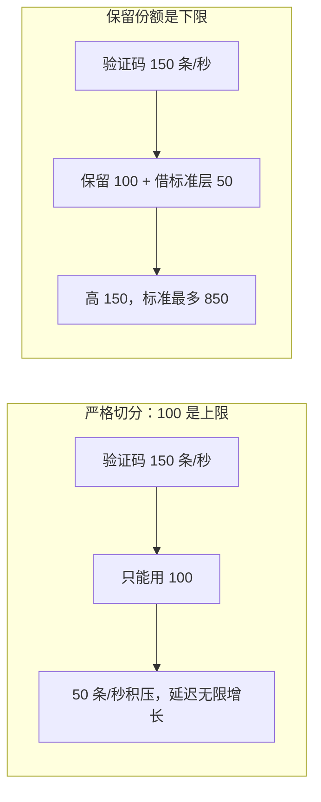

## Q
**通知系统 · 设计：保留份额是上限还是下限**｜考点 · 必会

Twilio 每秒 1000 条，高优先级保留 100 条/秒。一次账号攻击导致验证码需求涨到 150 条/秒，会发生什么？保留份额应怎样设计才合理？

## A
- **按严格切分（高优先级只能用 100）：** 多出的 50 条/秒排队，积压越来越多，验证码延迟随时间无限增长，违反 5 秒目标，而标准流量那边还有 900 的额度可能空着。
- **合理设计：** 保留份额是下限而不是上限。标准层永远不能碰那 100 条；高优先级可以在需要时借用标准层未用的额度。借用 50 后：高优先级 150，标准最多 850。
- **借用规则：** 单向借用，高优先级可借标准层，标准层不可借高优先级；借用后下一秒窗口重新计算。
- **取舍：** 标准层被挤占会变慢，但标准流量本来就能容忍；而验证码延迟不可容忍。
- **加分：** 还应对高优先级设总量上限和告警，这是 150 条/秒的异常，可能是被滥用或被攻击，应触发风控，而不是无限制地让它吃掉容量。

