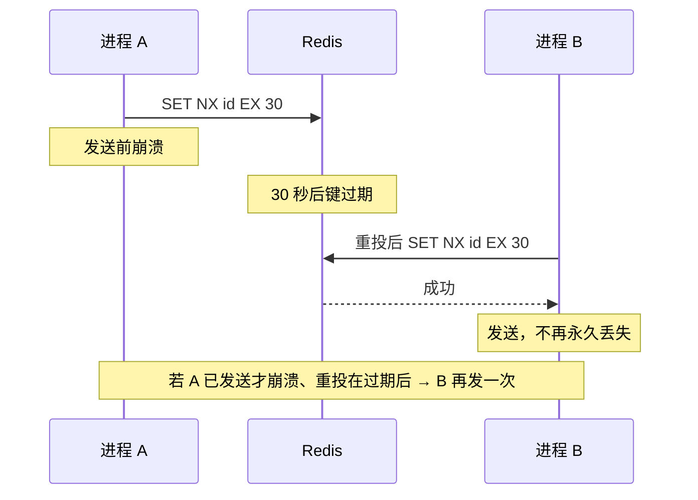

## Q
**通知系统 · 评估：给占坑的键加 30 秒过期够吗**｜考点 · 必会

有人修补"先 SET NX 占坑再发送"：给键设 30 秒过期，崩溃后键会自己消失。这能救回至少一次吗？还有什么问题？

## A
- **能救的部分：** 进程 A 占坑后在发送前崩溃，30 秒后键过期，重投的 B 可以占到坑并发送，不再永久丢失。
- **新问题一，窗口：** 若 A 实际发送成功、删除消息前崩溃，且重投发生在键过期之后，B 又会发一次，重复窗口和"发送前检查、成功后记录"方案相同。

- **新问题二，超时关系：** 过期时间必须与队列可见性超时配合。过期太短，A 还在慢调用时 B 就占到坑，两个进程同时发送；太长，崩溃后恢复变慢。
- **新问题三，没有永久记录：** 租约（lease）过期后键消失，之后同一条消息从死信队列回放或调用方迟来的重试，都查不到"已发送"，要另外写一个成功之后的永久标记。
- **更完整的做法：** 短租约防止同时发送，加成功后写入的"已发送"标记防止之后重复；两者组合，但仍然不是精确一次。
- **结论：** 租约把"最多一次"改回"至少一次"，但没有消除重复，需要后置标记配合。
