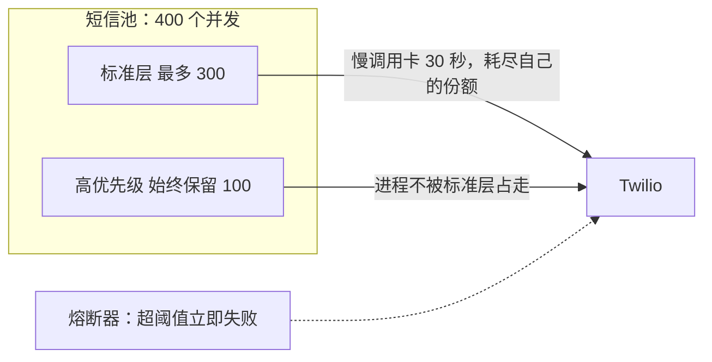

## Q
**通知系统 · 计算：服务商变慢后吞吐掉多少**｜考点 · 必会

正常时 Twilio 平均耗时 0.4 秒，短信池有 400 个工作进程并发调用。p99 涨到 30 秒、平均也涨到 30 秒后，吞吐是多少？为什么需要舱壁？

## A
- **正常吞吐：** 并发 ÷ 延迟 = 400 ÷ 0.4 = 1,000 条/秒，正好用满 1000 的额度。
- **降级后：** 400 ÷ 30 ≈ 13 条/秒，下降到原来的约 1.3%。要维持 1000 条/秒需要 30,000 个并发调用，不现实。
- **没有舱壁的后果：** 如果高优先级和标准共用同一个池，所有进程都卡在慢调用上，验证码也发不出。
- **舱壁的作用：** 为每个服务商（以及每层）限制最大并发，例如标准层最多占用 300 个，高优先级始终保留 100 个，标准层在服务商变慢时自己耗尽自己的份额，不会吃光高优先级的工作进程。
- **熔断器的作用：** 失败率与超时率超过阈值后立即失败，不再等 30 秒，释放进程，并触发切换备用服务商。
- **结论：** 用并发 ÷ 延迟的算术说明为什么延迟涨 75 倍吞吐就掉到不足 2%，比空谈"要做容错"更有说服力。

