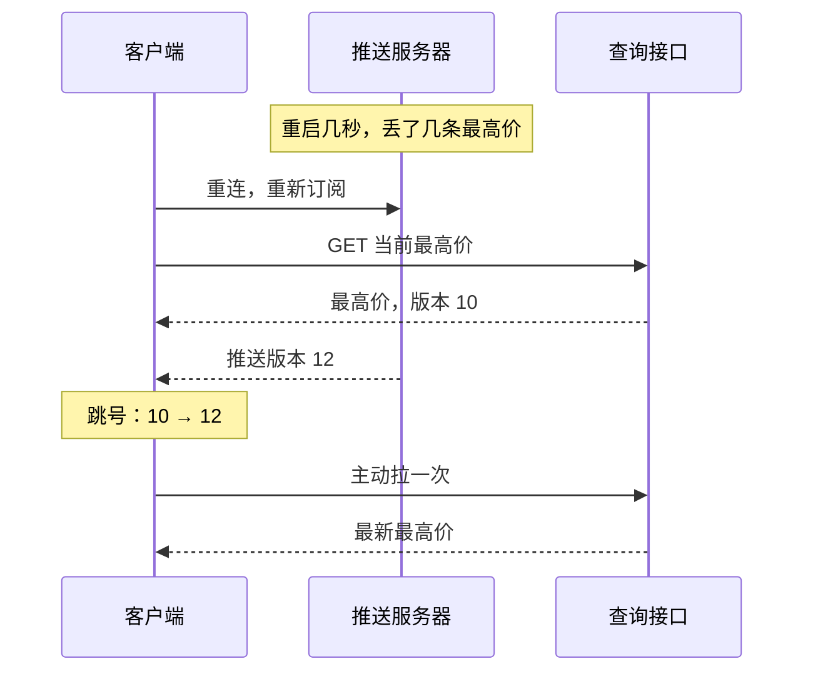

## Q
**在线拍卖 · 找错：发布订阅丢了一条更新，客户端永远旧**｜考点 · 必会

发布订阅（如 Redis Pub/Sub，至多一次投递）在一台推送服务器重启的几秒内丢了几条新最高价。重连后，客户端的最高价会怎样？怎么设计让它自愈？

## A
- **现象：** Pub/Sub 不存消息，订阅者不在线时的消息直接丢失。服务器重启后，客户端重新连上，如果只等下一条推送，那么这几秒内的最高价它永远不知道，直到下一次出价。
- **自愈设计：**
  - 每个事件带单调递增的版本号（该拍卖的出价序号）；
  - 客户端重连时先 `GET` 一次当前最高价（用 SSE 的 `Last-Event-ID`，或直接调接口），再接着监听推送；
  - 客户端看到版本号跳号（收到 12，上一个是 10）就主动去拉一次；
  - 低频兜底轮询（比如 30 秒一次），防止所有机制都失败；
  - 服务端重连时也要重新订阅频道，并立刻对这批连接补发一次当前值。
- **关键：** 推送是"提示"，真正的数据来源是可查询的接口；推送丢了，用户也只是晚一点到最新。
- **提交前还有最后一道防线：** 出价请求本身带用户看到的最高价，服务端用原子比较决定，所以显示旧值不会破坏正确性，只影响体验。
- **模式。** 提示加拉取：用推送降延迟，用拉取保证最终正确。

