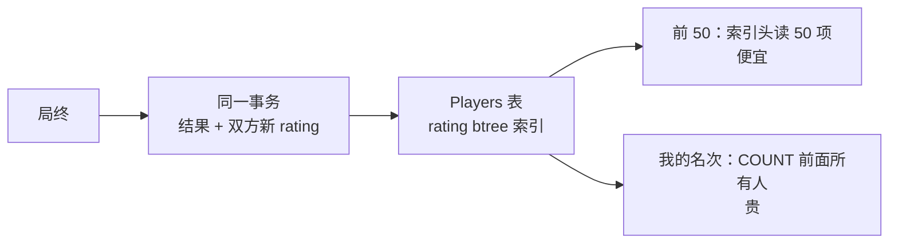

## Q
**在线象棋 · 高层设计三：排行榜**｜摘要 · 必会

最朴素的排行榜怎么做？取前 50 名和查自己的名次，哪个会出问题，为什么？

## A
- **做法：** Players 表已有 rating 和胜负数。局终时游戏服务根据结果和开局时的 rating 算出新分，**在同一事务里存结果和双方新 rating**；榜单直接读表，下一次请求就能看到。
- **前 50 名很便宜：** rating 上有 btree 索引，`ORDER BY rating DESC LIMIT 50` 从索引头读 50 项就停，不用排 1000 万行。
- **自己的名次很贵：** `SELECT COUNT(*) WHERE rating > :mine` 要数完前面所有人。btree 有序但不记位置，没有 O(log n) 的办法回答"你是第 4,201,930 名"；越靠后越慢，中游玩家也有几百万人在前面。

- **后续：** 深入四用分段计数（近似）或 Redis 有序集合（精确）解决名次。
