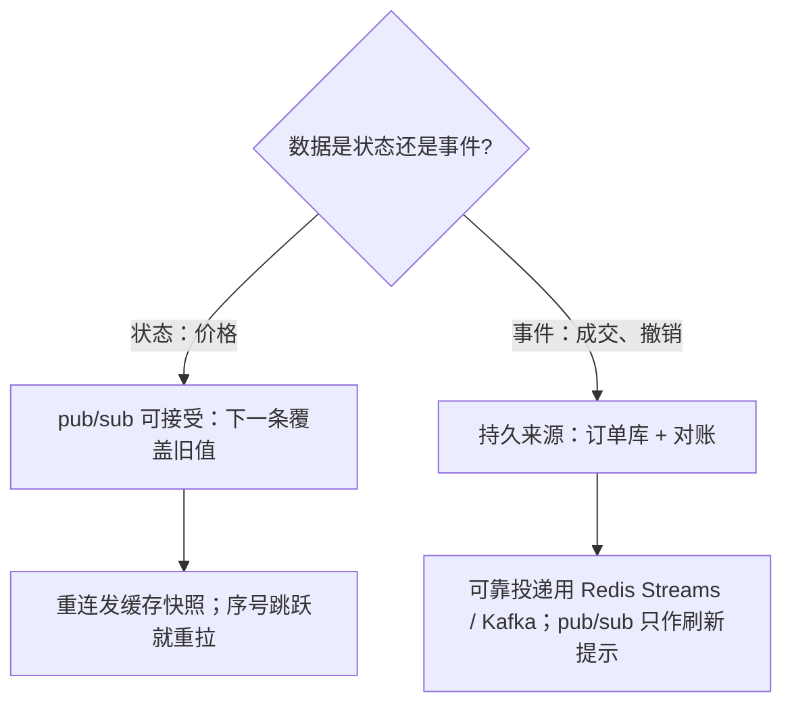

## Q
**股票交易平台 · 拓展：Redis 发布订阅是"至多一次"**｜拓展 · 加分

Redis 的发布订阅不保存消息。符号服务断线重连、或 Redis 故障转移期间，会错过价格吗？行情和订单状态对这点的容忍度一样吗？

## A
- **事实：** Redis pub/sub 是即发即弃（fire-and-forget）：消息只投递给当时在线的订阅者，不持久化，没有确认和重放。订阅者断开期间的消息就丢了。
- **对行情可以接受：** 价格是状态，下一条更新会覆盖旧值；错过几个中间值，用户看到的是稍微滞后的价格。重连后用缓存里的最新价做快照，就恢复了。
- **要补的机制：** 重连后立刻发送缓存快照；可给每个符号的价格带序号或时间戳，客户端发现序号跳跃或太久无更新时主动重新拉取。
- **对订单状态不可接受：** 成交、撤销是事件，丢一条就永久不一致。订单更新不能只靠 pub/sub 推送，要有持久来源（订单库）和对账；pub/sub 只作为"通知刷新"的提示。
- **需要可靠投递时：** 用带持久化和消费位点的流（如 Redis Streams 或 Kafka）。
- **模式。** 状态可丢中间值、事件不能丢：选传输可靠性要看数据的语义。

