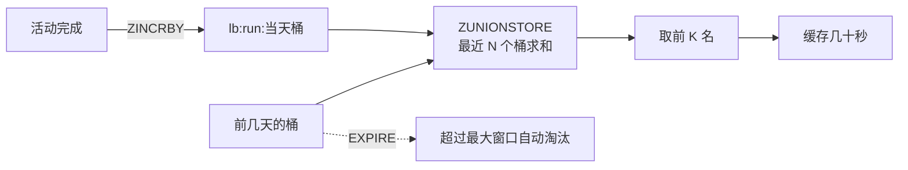

## Q
**Strava 运动记录 · 找错：Redis 排行榜的时间范围查询**｜考点 · 必会

方案是把每个活动存成 ZSET（分数是时间戳）加 HASH，查"过去 24 小时榜"就把窗口内所有活动 ID 取出来，在应用里按用户汇总。每天约 1 亿个活动，这样做会怎样？更合理的结构是什么？

## A
- **问题：** 窗口内约 1 亿个活动 ID 要全部取出，再对每个 ID 读 HASH，是上亿次读和上亿个元素的内存汇总，一次查询要数十秒甚至更久，缓存失效瞬间的延迟尖峰很大。
- **更合理：** 按时间分桶。每天（或每小时）一个 ZSET：`lb:run:2026-11-03`，成员是用户，分数是该用户当天的总距离，活动完成时 ZINCRBY 当天桶。
- **查询过去 N 天：** 用 `ZUNIONSTORE` 把最近 N 个桶按分数求和成一个临时集合，再取前 K 名；结果缓存几十秒。每个桶里一个用户只占一个元素（同一用户多次活动已被累加），合并的是用户汇总而不是活动明细，用户在多天里重复出现时元素数比活动数少得多。

- **过期：** 给每个桶设 EXPIRE，超过最大窗口自动淘汰，无需清理。
- **取舍：** 窗口的粒度只到桶的大小（如按天，则"过去 24 小时"需要用小时桶才精确）；桶越细，合并的桶越多。
- **模式。** 时间分桶：把滑动窗口的聚合分解成多个固定窗口的预聚合。
