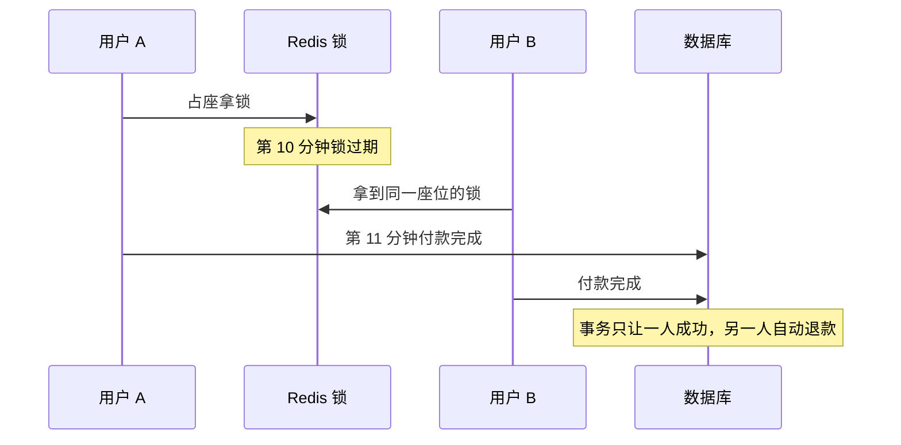

## Q
**票务系统 · Redis 占座的三个挑战**｜摘要 · 必会

占座放在 Redis 之后，座位图怎么显示预留？Redis 挂了会双订吗？支付期间锁过期怎么办？

## A
- **座位图读路径：** 预留不在数据库，活动服务要把预留座位显示为不可选。用普通集合会有幽灵条目，因为成员不会随锁过期而消失。应使用有序集合，以锁的到期时间为分数（`ZADD event:{id}:reserved <expiresAt> ticketId`），读时只统计分数在未来的成员，必要时用 `ZREMRANGEBYSCORE` 清理。也可以获取锁时把 reserved 写通到数据库，把 Redis TTL 当作过期依据，定期清扫。
- **Redis 挂了：** 体验降级，但不会双订，因为数据库用 OCC 或行级锁兜底；用户可能填完支付才失败。这仍好过 cron 失败时所有票都显示不可用。
- **支付期间 TTL 到期：** 用户 A 在第 10 分钟锁过期、第 11 分钟付款完成，B 可能已拿到锁。数据库事务只会让一人成功，另一人自动退款。TTL 设得宽裕，支付发起时延长锁。

