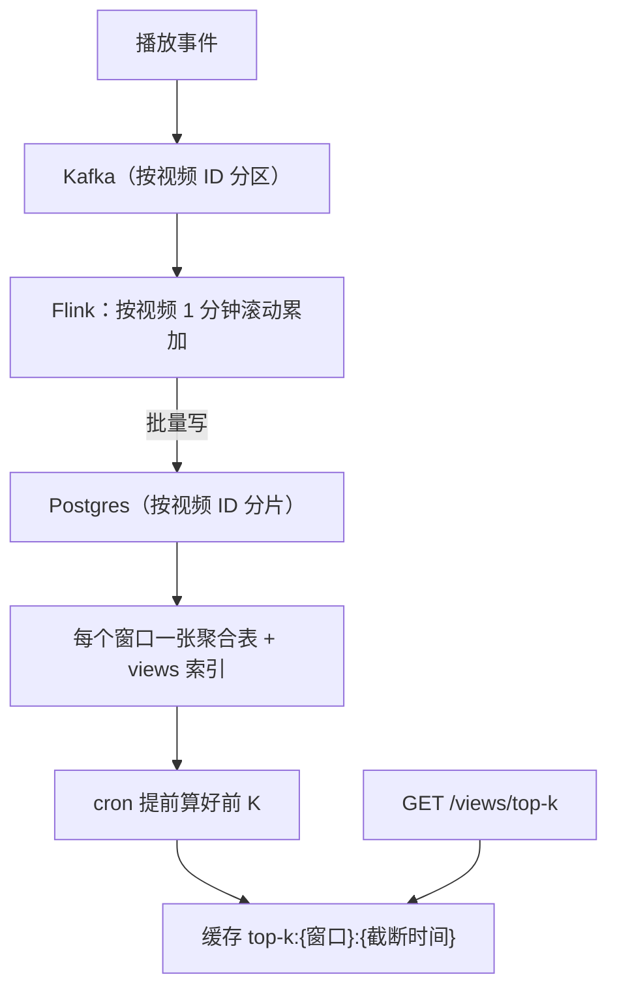

## Q
**Top K · 完整解答**｜摘要 · 必会

设计 YouTube 视频播放量的 Top K 系统：输入是海量播放事件流，要能查询最近 1 小时、1 天、1 月和全部时间内播放最多的 K 个视频。给出路线、需求、接口、整体设计、深入问题和各级别期望。

## A
**一句话。** 这是"流式计数加取前 K"：算法本身简单，难点是每秒约 70 万次写入、窗口求和的大扫描、几十毫秒的读延迟。答案是：按视频分片、批量聚合写入，为每个窗口维护预聚合表，读请求只走预先算好的缓存。

**60 分钟路线。**

| 时间 | 做什么 |
|---|---|
| 0–5 分 | 澄清窗口类型、时间范围、K 的上限；定下 1 分钟入账、精确、几十毫秒 |
| 5–10 分 | 实体（视频、播放、时间窗口）和一个查询接口，不多停留 |
| 10–20 分 | 基础版：Kafka、消费者、Postgres 加索引；再加小时级时间戳；主动点出瓶颈 |
| 20–50 分 | 必讲：缓存与预计算；写入估算、分片与批量；窗口预聚合表 |
| 50–60 分 | 追问：滑动窗口、Count-Min Sketch 近似、专用数据库 |

- **需求**
  - 功能：查询 1 小时、1 天、1 月、全部这四个滚动窗口的前 K 名，K 最多 1000。任意时间段、任意起止点划在范围外
  - 非功能：播放到入账不超过 1 分钟；结果精确；查询几十毫秒返回；播放量与视频数都是海量
- **实体与接口**
  - 实体：视频、播放、时间窗口。接口只有 `GET /views/top-k?window=&k=`，返回视频 ID 与播放数的数组，不分页
  - 播放写入不设接口，假设已有按视频 ID 分区的 Kafka 主题
- **整体设计**
  - 全时间：消费者把播放数累加进 Postgres，views 列建索引，查询沿索引取前 k 行，近似 O(k)；写入因索引维护变成 O(log n)
  - 加窗口：表里加小时级时间戳，每个视频每小时一行；查询变成跨小时 SUM 再排序，要扫描大量行
- **深入一，少查库（必讲）**
  - 缓存整份结果，键为 `top-k:{窗口}:{截断时间}`；缺点是过期瞬间大量请求回源并破坏延迟指标
  - 更好：cron 提前算好并写缓存，请求从不碰数据库；缓存多留几小时，预计算迟到时返回旧数据
- **深入二，写得动（必讲）**
  - 700 亿 / 10 万秒 = 70 万次/秒；单节点约 1 万次/秒，需要约 70 个分片。按视频 ID 分片，每个分片取前 K 再合并，结果正确
  - Flink 按视频做 1 分钟滚动累加再批量写，水位线容忍约 30 秒迟到（要严格 1 分钟入账就把窗口缩到 30 秒）；分片数随写入减少而下降
- **深入三，窗口查询快（必讲）**
  - 粗粒度汇总（小时、天、月）可行但依赖 cron；更好是每个窗口一张当前聚合表加 views 索引，读 O(k)，代价是一次写 4 张表
  - 全放 Flink 内存加 RocksDB 也行，但容易变成编码题，不推荐
- **追问再讲**
  - 滑动窗口：分钟粒度，每分钟加增量减去 60 分钟前那一分钟；务实做法是只让一小时窗口滑动
  - 近似：Count-Min Sketch 加前 1000 名有序列表；Redis 版可能丢状态，Flink 版可从检查点恢复
  - 专用库：InfluxDB 基数太高不行；TimescaleDB 与 Druid、Pinot、ClickHouse 靠预聚合可行，仍要缓存
- **级别**
  - 中级：端到端能跑，知道瓶颈在哪并解决一部分；高级：方案接近最优，能主动找出多数瓶颈并比较取舍；Staff：看清整个方案空间，快速给出判断，时间花在有意思的地方
